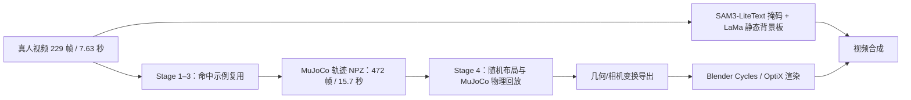

# DexAgent 流程审查与改进建议

- 审查日期：2026-10-13
- 审查对象：当前工作区代码、`dexagent.yaml`、`runs/reproduce_place_cup/` 运行记录和 Stage 4 产物。
- 范围：只读代码与产物审查；没有运行测试套件，也没有改动运行代码。

## 总体判断

当前已得到一组**有物理回放审计、可检查的 Stage 4 随机轨迹和多视角视频**。轨迹存在，MuJoCo 3.10.0 回放检查通过，Blender Cycles 使用了 OptiX。

但它还不能证明“DexAgent 在无 API 条件下由 Codex 独立完成了 Stage 1–4”：Stage 1–3 复用了示例，Stage 4 输出没有被写进根 `run_summary.json`，而且本次 Stage 4 配置与根 `dexagent.yaml` 的样本数和渲染分块配置不同。更准确的描述是：**沿用已验证示例轨迹，完成了 Stage 4 随机化、物理回放和合成渲染。**

## 按流程检查

| 环节 | 现状 | 审查结论 |
|---|---|---|
| Codex / Agent 调度 | `dexagent.yaml` 仍为 `provider: anthropic`，预算为 `null`；代码另有 `provider: external` 文件传输实现 | 当前对话里的 Codex 是外层操作者，但 `run_dexagent.py` 配置没有切到 Codex 所需的 external transport。当前运行因示例复用没有触发模型调用，不能视作已验证了 Codex 闭环。 |
| Stage 1–3 | 根配置 `examples.reuse: true`；记录为 0 次工具调用；Stage 3 交付称示例未重新验证 | 能快速复用同一任务，适合作为冒烟检查；不能验证新改的检测、场景理解和轨迹生成。 |
| Stage 3 视角/位姿检查 | `reuse.json` 的位置拟合记录为 `FatalError: gladLoadGL error`，并说明该拟合没有运行 | 结果没有因为这一项而失败，但“验证通过”的证据不完整。应修复 headless OpenGL/EGL 路径，或显式把此检查记为 `skipped`，不要把未执行的检查算作已通过。 |
| Stage 4 物理回放 | 2/4 随机样本通过，原始样本也通过；472 帧、7850 个子步；回放误差为 0 | 这是当前最有力的独立验证部分。失败样本报告为放置方向检查失败，而非模拟不稳定。 |
| 背景板 | SAM3-LiteText 提供擦除掩码，LaMa 补静态背景板 | 对静止 ego 相机是合理的轻量替代。它不等价于 VOID/CogVideoX 的时序修复。抽样覆盖仍有 3.36% 像素始终不可见，必须接受图像补全。 |
| 多视角图像 | ego 背景板投影给 wrist 相机使用 | 适合生成机器人动作视角预览；腕部视角出现大块灰色/平面区域，不能当作高保真的实拍腕部图像。 |
| 视频时间 | 真人视频约 7.63 秒；机器人轨迹 15.7 秒 | `compare.mp4` 将真人帧均匀重采样到合成视频的帧数，没有真实时间戳或逐帧动作对齐。只能做阶段/视觉对照。 |

## 优先处理的问题

### P0：让“无 API、Codex 做决策”成为实际运行配置

当前 [`dexagent.yaml`](dexagent.yaml) 写的是 Anthropic provider、Claude 模型、没有预算上限；Anthropic/OpenAI 模式在预算为空时会被 harness 拒绝调用，所以这份配置既不是 Codex，也不是一个能直接启动的无 API Codex 闭环。仓库已有 [`agent/external.py`](agent/external.py) 文件传输协议，可以承接外部模型的工具选择，但它只生成 request 文件并等待 response 文件，**不会自动启动当前 Codex 对话或 Codex CLI**。

建议把正式运行配置改为 `provider: external`，把 `transport_dir` 放在 `/data`，再由当前 Codex 会话/一个轻量桥接器读取请求、生成合规 tool-use JSON 并写回响应。这样 DexAgent 仍负责真实工具执行、预算边界、验证和交付，Codex 负责模型决策；全程不需要 DexAgent 调模型 API。另开一次全新运行验证此链路，不要从示例复用路径判断它有效。

### P0：用全新运行证明 Stage 1–3，不要让示例复用掩盖回归

`examples.reuse: true` 是本次 0 工具调用的直接原因。替换了对象检测模型之后，Stage 1–2 没有重新调用它；Stage 3 也没有重新规划轨迹。建议复制配置并关闭复用，使用新的 run name；要求每个阶段留下自己的 `progress.json`、`trace.jsonl`、verifier 报告和有效 `delivery.json`。现有 `stage3/run.json` 的 GL 位姿拟合跳过问题也应在新跑前处理。

保留示例复用作为快速 smoke 模式是合理的，但结果名称/报告要区分 `reuse smoke` 和 `fresh evaluation`，避免把两者都显示为同一种 PASS。

### P1：固定 Python 环境路径，并保护 `/data` 缓存策略

根配置的 `environments.sam3` 和 `environments.stage4` 都是空值。空值会让工具和 Stage 4 继承启动 `run_dexagent.py` 的 `sys.executable`。本次检查的交互 shell 默认在 `/data/miniconda3` base，MuJoCo 为 3.7.0 且没有 Torch；而产物记录的仿真版本是 3.10.0。若从这个 shell 直接启动，可能用错环境或在加载模型/Blender 时失败。

建议在正式配置中把 SAM 与 Stage 4 Python 明确指向 `/data/miniconda3/envs/dexagent/bin/python`（或检查后确定的专用环境），并在启动时打印 `sys.executable`、Torch、Transformers、MuJoCo、bpy 版本。模型目录和 `HF_HOME` 已设在 `/data`，这是好的；但独立运行 `stage4_robot_data_generation/setup.sh` 时，如没有导出 `HF_HOME`，Hugging Face 默认缓存仍可能落到 `~/.cache/huggingface`。另外运行入口用 `setdefault("HF_HOME", ...)`，如果 shell 已设置了另一个 `HF_HOME`，配置中的 `/data` 路径不会覆盖它。setup 应显式设置并打印最终 cache 路径，安装使用 `python -m pip`，避免 pip/python 不配套。

### P1：统一根配置、Stage 4 配置和总运行记录

- 根配置设 `stage4.num_samples: 3`、`render.chunks: 4`；当前任务配置是 2 个随机样本、1 个 chunk、`parallel: 1`。当前视频产物因此不能由根配置单独复现。
- 根 [`run_summary.json`](runs/reproduce_place_cup/run_summary.json) 只列 Stage 1–3；Stage 4 的通过结果单独存在 `stage3/stage4_task/outputs/randomize.json` 和样本目录中。
- Stage 4 runner 当前把固定流水线的 5 个步骤填到 `tool_calls: 5`，这容易被误解成 5 次 agent 工具调用；建议报 `steps_completed`。

建议每次开始时保存一份不可变的 `effective_config.json`，记录 Stage 1–4 实际参数、环境路径、包版本、checkpoint SHA、随机种子、输入视频哈希和各阶段产物路径。总 summary 应把 standalone Stage 4 结果也纳入，且清楚区分模型调用、库工具调用和固定流水线步骤。

### P1：限制渲染进程和 GPU 的关系，避免多进程重复占用所有显卡

当前完整渲染日志报告 `[render] cycles device: OPTIX`，证明走了 GPU。`parallel: 1` 只限制同时运行的 Blender 子进程数；[`render_cycles.py`](stage4_robot_data_generation/stage4/render_cycles.py) 会把当前发现的该类型设备全部启用，因而不能解释为“只用一张 GPU”。更危险的是，[`run_stage4.py`](stage4_robot_data_generation/run_stage4.py) 在配置省略 `parallel` 时用 `parallel = chunks`；根配置给 `chunks: 4`，所以 4 个 Blender 进程可能各自启用全部可见 OptiX GPU，显存峰值会叠加。

建议先把默认并发固定为 1。若以后需要多卡并发，增加显式 `gpu_ids`，按 chunk 给每个 Blender 子进程分配互不重叠的 `CUDA_VISIBLE_DEVICES`/设备 ID；不要只把 `chunks` 或 `parallel` 调大。已检查的 5 份完整视角日志每视角耗时约 711–828 秒（约 12–14 分钟），这是最明显的计算耗时。可先对固定代表帧比较 8/16/32 samples；Cycles 已启用降噪，低样本可作为预览配置，确认质量后再决定全量参数。

### P1：标清腕部视角的背景限制

[`export.py`](stage4_robot_data_generation/stage4/export.py) 的 `reproject_plate` 只对桌面平面把 ego 画面反投影到腕部相机；超出桌面或 ego 图像范围的区域被填成 room median。已抽查的三视角 preview 中，腕部背景存在明显灰色平面/无纹理区域。这是几何信息不够导致的，不是换一个分割模型能解决的。

如果数据要训练多视角视觉策略，优先级应是获得真实 wrist camera 视频或重建固定房间的 3D 背景（至少桌面以外的结构），再做相机视角合成。若暂时没有这些数据，训练集要显式标记腕部背景是合成/重投影，并先只把 ego 视角当作真实背景质量基线。

### P2：提高随机布局通过率，减少昂贵的失败回放

本次两个失败布局的杯子相对碗 yaw 分别约 −26.2° 和 −24.6°，放置朝向误差为 17.1° 和 17.7°；两个通过布局的相对 yaw 都约 −4°。这四个样本不足以认定准确边界，但方向很清楚：杯子与碗的 yaw 独立从 ±15° 采样会产生不容易放入的相对朝向。

建议把杯子/碗的相对 yaw 作为一个耦合采样量，先尝试较窄的相对角度（例如 ±8°，之后按物理结果逐步放宽），再做轻量几何/IK prescreen，最后仍保留完整 MuJoCo 回放作为接受条件。本次物理尝试耗时 697 秒，原始轨迹回放另耗 188 秒；任何前置筛选都应以不漏掉可行动作为目标，不可替代最终物理审计。

### P2：让分割后端可替换，并补上跨帧质量评估

目前检测和分割工具将 SAM3-LiteText 适配器写在 [`detect_objects.py`](tool_library/skills/detect_objects.py)，Stage 4 掩码又在 [`masks.py`](stage4_robot_data_generation/stage4/masks.py) 直接调用同一个模型。架构上能跑，但以后替换模型需要改多处。Stage 4 对 85 帧和 4 个文本提示逐一做图像文本推理，没有跨帧 mask propagation；单帧模型容易出现掩码边界抖动，且 union mask 不利于定位哪个 prompt 漏检/误检。

建议抽成统一的 `segment(image, prompts) -> masks/scores/boxes + model_identity` 后端接口，同时区分“文本提示图像分割”和“视频提示传播”能力。模型比较不要只看模型名：用相同的几十帧、提示词和人工抽样真值，记录目标召回、误擦除面积、边界漏检、跨帧抖动和 clean-plate 质量。当前 LiteText 是可用基线；若重点是连续视频掩码，可增加视频传播型后端做同一基准比较，而不是直接假定任意分割模型可互换。

### P2：固定依赖和权重版本，做到可重复安装

当前依赖允许 `transformers>=5.6,<5.14`、`accelerate>=1.1`，实际记录是 Transformers 5.13.1；设置脚本会下载 Hub 仓库的当前 snapshot，而不是指定 revision。运行时记录了 SAM 权重 SHA，这有助于追溯，但安装阶段仍没有 lock 文件或固定 revision。LaMa SHA 只在笔记中记录，setup 下载后未校验。

建议固化 Python 3.11 环境锁（或 `pip freeze`/conda explicit spec）、Hub revision 和 LaMa SHA-256；输出目录保留这些值。这样才能分辨“模型升级导致输出改变”和“代码改变导致输出改变”。

## 建议的执行顺序

1. **先固定目标运行方式：** `provider: external`、Codex 文件响应路径、模型环境 Python、HF cache 全部明确到 `/data`。
2. **做真正的新鲜 Stage 1–3：** 关闭示例复用、修复/显式处理 GL 位姿拟合，并使用新 run name。确认 Stage 1–3 有新 trace 与验证收据。
3. **统一 Stage 4 配置和审计：** 根配置与任务配置只保留一个最终来源；summary 写入有效配置、环境和 Stage 4 结果。
4. **先降低失败和渲染成本：** 加入相对 yaw prescreen；先固定低采样预览帧，再确定 Cycles 全量采样数；并发保持 1，直到 GPU 按设备隔离实现完成。
5. **再评估数据用途：** 若目标是训练数据，补充 human-to-simulation 时间映射、腕部真实背景/相机数据和明确的数据 schema；若目标只是验证 Stage 4 合成能力，现有 ego 视角和轨迹已足够作为基线。

## 做得比较好的部分

- Stage 4 保存了状态轨迹、动作标签、逐子步记录和样本级 JSON 审计，不是只有 MP4。
- 随机布局都要求物理回放；原始回放与两个接受样本都有可检查的报告。
- SAM checkpoint 有运行时权重哈希；LaMa、SAM 模型和 Conda 环境都放在 `/data` 路径，减少写满系统盘的风险。
- 渲染帧使用 cache key，并在缺帧时跳过已有帧；这使渲染失败后的恢复成本可控。
- 当前运行配置把 Blender 子进程并发限制为 1，避免了同一次运行内多个渲染进程同时启动；需要再加设备级隔离，才能对共享 GPU 负载作可靠控制。
