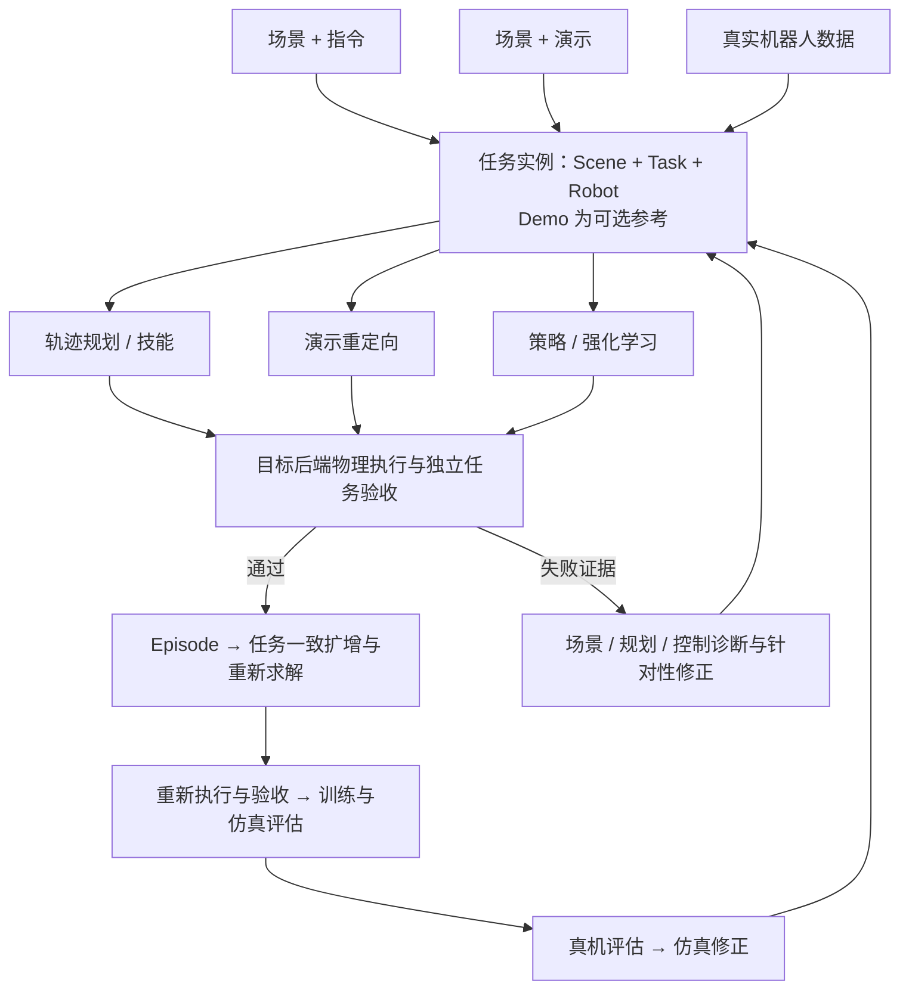

# EmbodiForge 统一 Real2Sim2Real 工作流

2026-10-20，按用户最新明确的系统定位修订。

**EmbodiForge = 真实世界资产构建 + 任务理解 + 机器人执行与验证 + 数据生成平台。**

## 主流程与输入

多源场景采集 / 导入 → 可交互仿真场景构建 → 任务理解与实例化 → 机器人动作生成 / 重定向 → 物理执行与反馈验证 → 数据扩增与策略训练 → 真机评估与仿真修正。

这条流程表达模块依赖，不要求每次任务从头扫描，也不要求场景采集和示范采集严格串行。Scene、Demo、Task、Robot 分别复用，任务实例绑定具体版本与执行配置。Demo 是可选参考。

| 入口 | 提供什么 | 需要恢复或求解什么 |
| --- | --- | --- |
| 演示驱动：场景 + 人类/机器人视频 | 操作对象、阶段、接触关系、运动参考 | 示范到场景的配准、任务约束、目标本体动作 |
| 指令驱动：已有场景 + 自然语言 | 任务目标、对象指代与约束 | 任务实例、专家动作；不强制采集示范或训练 RL |
| 数据驱动：真实机器人数据 | 视频、状态、动作、时间与本体信息 | 场景/控制语义恢复、可执行 Episode 与目标后端验证 |

新 Ego 采集推荐先扫描环境，再收集多段示范以利用同一地图与标定；这是推荐采集实践，不是全平台门禁。近期先完善单目 RGB，双目/RGB-D 作为后续输入扩展。

## 最小统一边界

| 概念 | 职责 | 优先复用的当前实现 |
| --- | --- | --- |
| Scene | 环境、支撑/碰撞几何、对象实例、尺度/坐标、视觉资源及版本 | SimFoundry 原生场景与资产；RSS Scene / BuildRequest；已有场景候选与编辑快照 |
| Demo | 源视频/机器人数据、时间映射、相机与手/对象轨迹、到场景的变换及不确定性 | DexAgent 输入、EgoDex/HaMeR 读取；保留原始数据与派生记录 |
| Task | 对象、初始状态、阶段约束、接触关系、目标状态与成功谓词 | `scene_semantic.json`、现有 subgoals、关系检查与 task gates |
| Robot | 机构、安装、执行器/控制映射、工具、限位与传感器 | 现有 setup、RSS EmbodimentSpec / Binding、本体控制桥 |
| 任务实例 | 连接具体 Scene + Task + Robot，按需附 Demo，冻结配置与来源 | 现有运行请求、候选身份、run metadata 和报告，逐步补齐缺项 |
| Episode | 实际动作、状态、观测、物理反馈、任务结果与来源 | 原生 recorder、执行报告、Workbench bundle / replay |

图中的 TaskSpec 表示统一任务语义；先映射现有字段与执行接口，不新增一套与现有任务系统并存的注册表。对象、接触与成功条件保持本体无关；动作、观测、工具能力和控制频率由目标机器人解释。

资产可自由选择不等于任意组合已可执行。组合后检查可达性、碰撞、机构与控制语义。严格 Real2Sim 保留源环境和本体；可迁移任务继续要求同任务、同布局、同判据在现有 YAM + Sharpa、G1 Omnipicker、G2 Omnipicker 分别通过。

## 动作与反馈闭环

轨迹规划、演示重定向、技能、策略和强化学习是可替换或组合的动作来源。没有示范时可以规划；有示范时也允许重新求解不可达动作。RL 的奖励不替代独立成功判据。

失败先依据证据分类：几何/尺度/碰撞与接触模型问题回到场景；不可达、路径碰撞或关系不满足回到动作求解；控制映射、跟踪误差或驱动问题回到本体控制。不能用任意移动布局、放宽门禁或隐藏失败来得到成功报告。

验收后的 Episode 才进入任务一致的扩增：场景、对象或布局变化后重新求解动作并复验，记录随机种子、资产版本和新结果。随后用于策略训练、仿真评估与真机评估；真实失败形成修正场景/控制模型的依据。数据打包完成不等于训练或真机闭环完成。

## 融合原则与当前边界

优先复用 SimFoundry 场景/资产构建、DexAgent 任务理解与动作工具、RoboSimStudio 交互和物理反馈。保留各项目成熟后端，通过最小接口交接任务、资产与证据，**不提前强制迁移全部仿真引擎**。跨后端转换必须在目标后端重新验证。

用户提出的 ARSTAG 任务驱动、Dex-One2Many 关系约束/RL、Video2World 功能正确性作为后续参考方向；具体采用必须回到源码与实验证据，本文件不构成这些工作的复现声明。

HumanEgo 的数据处理、ICT 关系表示和 Policy Sim 可分别补充 Demo 输入、策略动作源与闭环诊断；其 Real2Sim 页面另走 DexAgent 路径。沿用以上统一边界，区分图像去臂与三维背景清理、策略终止与物理成功、渲染变体与独立物理样本。源码与公开数据核验见 [HumanEgo 审阅](HUMANEGO_SOURCE_REVIEW_20261020.md)；当前尚未完成模型和物理任务复现。

已通过既有工具库接入 [HumanEgo 已处理示范](HUMANEGO_IMPORT_20261021.md)，完整导入公开 040 会话的 544 帧，保留实测时间、Aria 骨架和原始记录。未提供场景配准时不生成 rig 相机；提供变换也只代表接收了配准参数，几何和机器人任务仍需独立验收。

当前已具备运行管理、原生回放、部分场景/任务执行与门禁、数据打包；整场景坐标接入见[验证记录](WORKBENCH_RIG_FRAME_ALIGNMENT_20261020.md)，逐帧相机接入见[单目演示改进](MONOCULAR_MOVING_CAMERA_20261020.md)。通用 TaskSpec 实例化、独立扫描与示范自动配准、真实机器人数据完整恢复、G1/G2 动态任务、自动扩增训练及真机反馈闭环尚未全部完成，不能将现有局部验证当作统一主流程已通过。
