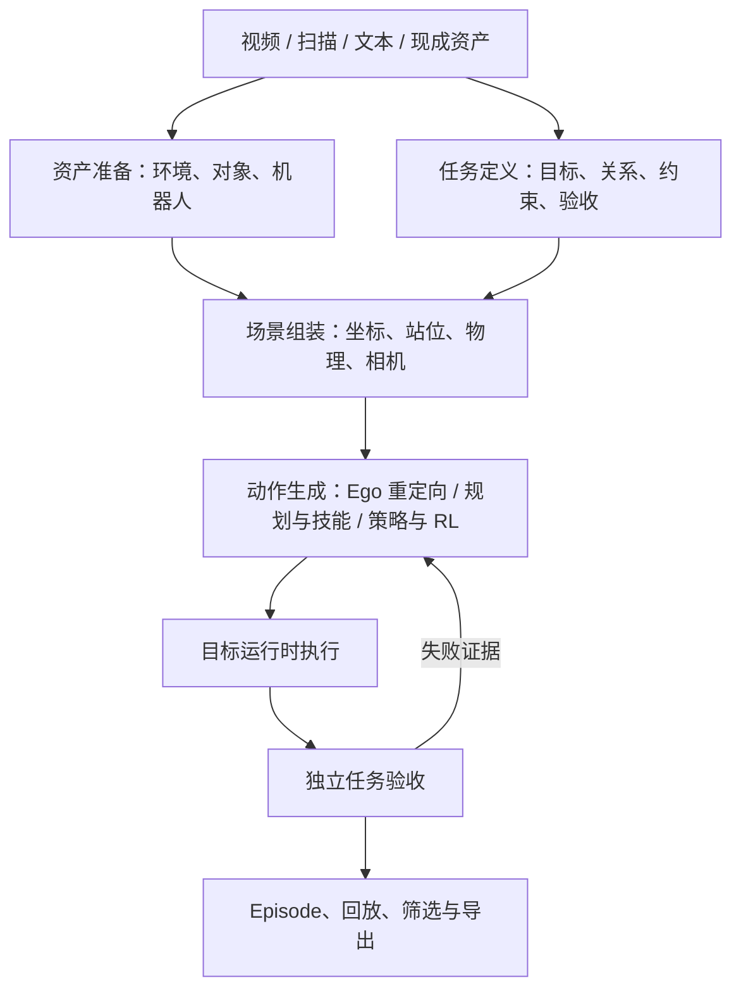

# 环境、本体与任务统一：三个项目的源码复核

2026-10-20。结论：**环境、可操作对象、机器人分别成为可复用资产；任务描述目标；一次运行选择资产组合和动作来源，再统一执行、验收和记录。** Agent 负责调用这些能力、处理失败与重试，不再复制一套场景、规划或成功判定。

本文核对本机关键调用链，记录现状与实施边界，并非三个项目所有代码的穷尽审计。本轮架构整理没有新增物理运行或完成跨本体任务。已有实测范围见 [GenieSim 接入审查](GENIESIM_ASSET_ADOPTION_20261020.md)。

审查版本：父仓库基于 `0a02ba1e23ecd3ab43691b58cea35c636ea826a8` 及当前工作区；RoboSimStudio `73739abe212f963e8a9f5862b27bca370df091a7`；SimFoundry `9e34ebefcd020583fbb755a8b57268dce78eca26`。目录含本地适配，以下结论针对所读工作树，不将其全部归为上游论文原始实现。SimFoundry 复现由另一对话负责，此轮只读核对。

## 一、统一后的职责



图中是职责分工，不要求新增六个服务、六套框架或六个注册中心。沿现有 Python 入口、RSS 类型、执行报告和 Episode 补齐接口即可；跨环境调用继续使用明确的进程与文件边界。

| 模块 | 唯一职责与产出 | 现有基础与限制 |
| --- | --- | --- |
| 资产准备 | 环境几何、视觉背景、对象几何/关节/物理属性、机器人模型；保留来源、依赖、单位和身份 | SimFoundry 重建/清理、GenieSim 素材、现有资产导入；生成文件不等于物理可用 |
| 任务定义 | 初始/目标对象关系、动作阶段、约束、成功判据及严格复现/可迁移目标 | DexAgent 任务与子目标、现有 task gates；不在任务意图中写死某本体的关节数组 |
| 场景组装 | 选择资产，确定世界/桌面/本体/工具坐标、站位、相机及仿真参数，冻结运行快照 | RSS `CellSpec`、`EmbodimentSpec`、`Binding`、`Scene/BuildRequest`；仍需验证组合 |
| 动作生成 | 对冻结场景生成本体可执行的动作或在线策略，并报告求解失败 | 保留灵巧手规划、增加夹爪适配；Ego、规划、技能、学习策略通过同一执行入口使用 |
| 执行与验收 | 按实际时钟运行物理，采集状态/接触；由独立判据给出任务结果 | RSS 运行时、现有控制桥和 task gates；构建、运动完成与任务成功分别报告 |
| 数据产出 | 记录实际状态、实际控制、参考动作、资产/坐标身份；回放、筛选和导出 | RSS `EpisodeRecorder` / `StateReplay`、现有 bundle 与 Workbench；按本体解释动作 |

Agent 统筹这些模块，选择已有工具并根据证据重试；Workbench 展示同一运行状态和产物，不自行推断成功。模型提供者在需要模型的环节替换，例如分割/传播、补全、几何重建或策略推理；调用方关心输入输出及能力，不强制绑定 Gemini、SAM 的某一版本。仅接口相似不足以认定可替换，替换后仍检查遮罩、帧身份、尺度或动作语义。

## 二、资产独立，运行时明确组合

环境保存地面、桌子、墙体和固定设施；对象保存可交互实体，按需带关节和物理属性；机器人保存机构、驱动、工具和机载传感器。对象资产本身不固定在某张桌子上，其位置属于场景实例。视觉材质和质量/摩擦分别配置，视觉随机化不隐式改变物理。

“运动部分是对象”可以帮助提名分割目标，但不能作为唯一分类规则：相机移动会使静态环境在图像中运动，演示中没动的杯子仍可能是任务对象。角色由任务与实体定义确定，运动线索辅助识别。背景中已烘焙的机器人/对象须实际清理、补全并重建，或者显式保留源绑定；隐藏单独加载的机器人无法删除扫描中的残影。纯视觉背景不能代替支撑与碰撞几何。

“机器人可以组合”应落实为**资产独立选择、组合后验证**：检查工具类型、臂数、站位、可达性、碰撞、控制语义和任务能力。不能只换模型名称后继续解释原来的关节动作。暂不可用的组合给出具体原因，保留已验证组合。

| 运行目标 | 固定内容 | 允许变化与验收 |
| --- | --- | --- |
| 严格 Real2Sim | 原场景、原本体、尺度、标定及对象关系 | 按源身份、重建保真和原任务验证；不强制公共桌子或替换三本体 |
| 可迁移任务生成 | 同一任务目标、对象关系、公共桌面布局与成功判据 | 各本体独立求解站位/安装、动作及控制；至少现有 YAM + Sharpa、G1 Omnipicker、G2 Omnipicker 全部通过 |

目标在任务建立时声明，不能因失败自动切换。可迁移任务使用地面 `z=0`、同一桌面高度 `H`，轮臂落地，固定臂按桌边安装；机器人不缩放。先确定三者共享的可行任务布局，再冻结为同一任务版本；若某本体不可达，不能暗中为它挪动物体继续宣称同一布局。

严格复现可继续整体导入旧场景，逻辑分离不要求立即拆尽所有文件。源场景与本体的身份锁定、公共桌面组合及三本体汇总验收仍需实现；现有类型提供了结构基础，并不自动完成这些约束。

## 三、Ego、规划、技能和强化学习的位置

有 Ego 演示时，复用对象轨迹、接触阶段、末端运动参考和任务关系，在目标机器人上重新求解 IK、抓取、碰撞和时序。人手姿态不能直接作为夹爪关节命令，也不能只将轨迹平移后认定重定向完成。示范不可达或接触不成立时，应报告并重新规划。

没有演示时，先考虑任务规划、现有技能和运动规划；需要通过试错学习接触技巧或鲁棒策略时再接强化学习。RL 也是动作生成方式，前置条件仍是有效场景、本体控制、观测、reset、奖励、终止条件和独立任务验收。不能把“没有演示”直接等同“必须训练 RL”，也不能将奖励高当作成功。

这些方式可组合：示范/规划生成初始轨迹，学习策略改善执行，执行失败由 Agent 依据诊断重新求解。共享任务关系、场景与记录，保留各本体正确的控制。当前没有在本轮建立通用 Ego 重定向或 RL 训练链路。

## 四、DexAgent：复用任务与规划，但解除具体本体耦合

实际关键路径：

```text
setup.yaml / scene.xml
→ Stage 2 重建、相机与布局适配 → Stage 2 gates
→ Stage 3 手部抓取、子目标与机械臂求解
→ compile_rigid → 有界机械臂控制和物理执行
→ Episode 打包与任务 gates
→ RSS SharpaBridge 重新执行、记录 → Workbench 回放
```

源码依据：

- [setup/setup.yaml](../setup/setup.yaml) 把原点设在两安装位中点的桌面投影，桌面为零；[stage_on_bench.py](../tool_library/skills/stage_on_bench.py) 从机械臂根计算布置。接公共世界时需保存完整变换，不能只调整显示高度。
- [place_egodex_camera_for_reach.py](../tool_library/skills/place_egodex_camera_for_reach.py) 和 [Stage 2 提示](../stage2_scene_reconstruction/prompts/stage2.md) 已含机械臂可达性驱动的相机/布局处理。若每换机器人重新执行这一步，任务布局可能跟着变；应区分场景恢复与本体可行性检查。
- [stage2_gate_suite.py](../tool_library/verifiers/stage2_gate_suite.py) 对照给定 setup 检查机构、限位、驱动、安装和 home。新本体要提供正确基准，不能跳过旧检查来兼容。
- [hand.py](../tool_library/common/hand.py)、[optimize_grasp_pose.py](../tool_library/skills/optimize_grasp_pose.py) 包含五指、拇指及手部局部坐标约定；[rigid_robot.py](../tool_library/common/rigid_robot.py) 的 `compile_rigid` 导入 YAM 机构。夹爪须有自己的抓取/工具适配，不能把手指名称改成夹爪名称继续用。
- [rss_sharpa.py](../agent/rss_sharpa.py) 明确要求 56 个物理关节/驱动（12 臂轴 + 44 指关节），当前不是 RSS 通用本体控制器；[rss_scene.py](../agent/rss_scene.py) 的 `TaskSceneEntity.build()` 整体导入 MJCF，**没有应用 `self.frame`**。更换 `CellSpec.surface_z` 不会自动抬高这份场景，另加桌子还会重复。
- [rss_episode.py](../agent/rss_episode.py)、[native_preview.py](../workbench/native_preview.py) 的机器人重建仍使用 SharpaBridge。已有 RSS 记录/回放机制可复用，但新本体需匹配自己的构建与动作映射。

任务的对象关系与成功语义可以复用；[task_gates.py](../tool_library/common/task_gates.py) 的身体/接触分组仍需按本体映射。例如 held 判据可依据接触和离开支撑面，而非要求所有本体共享五指实现。`ArmSide` 的底层链式 IK 可接显式关节列表，主要耦合在配置、装配、工具约定和调用方，并非所有 IK 都要重写。

## 五、RoboSimStudio：复用组装、执行、交互与记录

两条路径必须区分：

```text
Scene.add / robot → BuildRequest → compile_scene → Sim
taskdoc → lower → TaskSpec → Env → make_episode → compile_scene → Sim + evaluator
```

[Scene](../robosimstudio/robosimstudio/sim/scene.py) 构建出仿真不等于已有任务判定；[bench Env](../robosimstudio/robosimstudio_bench/envs/env.py) 会另外调用 `evaluator_for`。统一任务入口必须明确绑定现有有效 evaluator，而非靠配置一个 `TaskSpec` 获得成功结果。

可复用的结构及边界：

- [CellSpec](../robosimstudio/robosimstudio/specs/cell.py) 管地面、支撑面、静态实体及安装点；[compiler.py](../robosimstudio/robosimstudio/scene/compiler.py) 实际构建 `statics`，未在这条路径使用声明的 `CellSpec.asset`，背景应用 `StaticSpec(asset=...)`。
- `Binding.mount` 是世界坐标；命名安装点和非单位 `base_offset` 通过表面 frame 转换。默认偏移为单位变换时回退到请求位姿，不能假设所有机器人自动落在桌面。公共桌面坐标也不能替代任意旋转的源标定矩阵。
- [matrix.admits](../robosimstudio/robosimstudio_bench/taskbuild/matrix.py) 是候选筛选，已声明 Binding 会直接允许；`monolithic` 等限制不是编译器强制锁。`scene_resident` 只跳过重复导入，不验证源身份；`static_overrides` 只替换任务 scenery 的具名资产，不会自动拆机器人或改 Cell 的静态实体。
- [CameraSpec](../robosimstudio/robosimstudio/core/cameras.py) 默认使用世界坐标，固定相机不会自动随桌面平移；机载相机要明确父链接。编译器会加地面，严格复现须检查是否与源碰撞面重复。
- [ActionJointPosition](../robosimstudio/robosimstudio/solvers/control/action.py) 是每臂关节目标加一个夹爪标量；[Gripper](../robosimstudio/robosimstudio/solvers/motion/gripper.py) 将开合标量映射到配置关节。它不能直接替代 Sharpa 的独立手指控制。内置 YAM 夹爪模型也不等于当前 Sharpa 装配。

因此继续使用 RSS 的实体/本体注册和仿真基础，按需补小适配器；不建立第二套 registry，不为形式统一重写所有 Stage 3/4 为 taskdoc。

## 六、SimFoundry：复用重建资产与任务生成思路，核对坐标和动作

关键路径：

```text
支持面分割 / 世界坐标统一
→ 对象姿态尺度 → 几何与物理资产 → PyBullet 落稳
→ USD → OmniGibson 场景与机器人配置
→ 对象相对末端目标 / CuRobo 或策略执行 → 记录
```

源码依据：

- [4_unify_world_frame.py](../SimFoundry/scripts/pipeline/A_reconstruction/stages/4_unify_world_frame.py) 根据检测面原点和方向统一世界坐标；前级支持面类别可为桌面/台面，所以“Z-up、零平面”不必等于房间地面。必须保留源变换和支撑面语义。
- [14_create_og_scene.py](../SimFoundry/scripts/pipeline/A_reconstruction/stages/14_create_og_scene.py) 分别配置对象与机器人，但该路径仍写有 `arms = ["0"]`；机器人位置显式来自配置。加入桌子的分支计算了桌高，但按桌高放置对象的代码被注释，实际对象仅有 `z -= 0.005`。不能把 include_table 当成已验证的桌面自动适配。
- [pick_place_task.py](../SimFoundry/simfoundry/tasks/pick_place_task.py) 的 `_randomize_ground_plane_z` 同时移动地面、背景和非机器人对象，排除机器人。这是相对高度随机化，不是全场景坐标变换；reset 多次落稳失败后仍可能继续，我们的验收应保留实际稳定性结果。
- [data_gen_utils.py](../SimFoundry/simfoundry/utils/data_gen_utils.py) 使用对象相对末端目标，转换到世界再到机器人坐标，适合作为任务迁移参考；具体 IK/动作拼接仍依赖 default arm 和夹爪标量。
- [1_eval_policy_og_scene.py](../SimFoundry/scripts/pipeline/C_application/stages/1_eval_policy_og_scene.py) 限定单个机器人，且对 `action[7]` 处理夹爪反向/离散化。这不能直接作为所有双臂、灵巧手和移动底盘的统一动作格式。
- 当前 [simfoundry_assets.py](../agent/simfoundry_assets.py) / [rss_simfoundry.py](../agent/rss_simfoundry.py) 接入的是 Stage 8/11/12 的单刚体对象，在 RSS void 场景验证；尚不代表完整背景、机器人、相机及任务已从 OG 等价迁移。

场景状态分别存储几何引用与实体世界位姿的思路可复用。视觉背景、物理支撑和任务对象须分别表达；移动背景不能隐式带动所有世界坐标对象。跨后端保留来源并重新验证，不仅转换文件扩展名。

## 七、重叠能力如何收敛

| 重叠部分 | 统一归属 | 保留的内部差异 |
| --- | --- | --- |
| 环境/对象重建与资产导入 | 产出可复用资产，走既有资产入口和身份记录 | 视频/扫描重建、现成 USD/MJCF 导入各有适配；不强行合并模型环境 |
| 场景布局、坐标、机器人装配 | RSS 构建路径与一次运行的冻结组合 | 严格源场景整体导入与可迁移公共桌面两种有效入口 |
| 任务理解、子目标、失败重试 | DexAgent 现有 Agent 与工具流程 | 可用任何符合契约的模型或人工输入，不强制重复 Gemini 提案 |
| IK、抓取、策略、RL | 面向同一任务/场景的动作来源 | 五指抓取、夹爪抓取、不同工具轴/控制维度保留本体适配 |
| 成功判定、失败分类 | 既有 task gates 与报告，按任务选择唯一权威判据 | 源运行与目标运行证据分别保留；奖励、导入、外观、任务通过不混用 |
| 数据记录与前端状态 | 原生 Episode + 既有执行/报告接口 | 记录每本体实际动作语义和时钟；实际控制与参考动作明确区分 |

不复制三份“总 pipeline”。迁移顺序是新入口接通并验证后，停止新增旧重复入口；在调用方迁移和回归通过后再删除确认无用的实现。另一对话的 SimFoundry 复现作为能力来源接入。

## 八、实施顺序与验收

1. **先做现有本体的公共场景等价性。** 保留 YAM + Sharpa 的装配和控制，明确 rig-to-world 变换，解决整场景导入忽略 frame、桌子重复、固定相机变换的问题。核对 FK、对象关系、碰撞、执行和回放，旧严格复现结果继续按原坐标读取。
2. **资产与新本体并行补基础。** 修正 USD wrapper 去重与依赖闭包；G1/G2 先解决碰撞分解/过滤导致的求解器构建失败，再验证机构、限位、开合、工具与接触。当前仅有导入诊断，均未物理步进，不标为已支持任务。
3. **接入同一简单任务。** 冻结公共桌面、对象布局和成功判据，每本体单独规划、物理执行、验收、记录及回放。保留独立手指控制和夹爪开合控制；三者全部通过才认定可迁移 demo 完成。
4. **接多种动作来源。** 先复用已有规划与技能，再将 Ego 参考接入重定向；需要学习时补 RL 的观测、动作、reset、奖励和终止接口。用同一物理与任务验收检查不同来源。
5. **扩展随机化与数据生产。** 先视觉材质/光照，再任务关系允许的布局及物理变化；涉及可达性和接触的变化重新规划/验收。记录 seed、资产身份、组合和结果，前端展示真实通过/拒绝样本。

当前代码实测状态、16 项导入回归、146 项 Workbench 回归及 8765 报告入口见 [接入审查](GENIESIM_ASSET_ADOPTION_20261020.md)。这些是前一实现增量的验证；本文只完成源码复核和职责/实施顺序整理，未把方案标成已实现。
