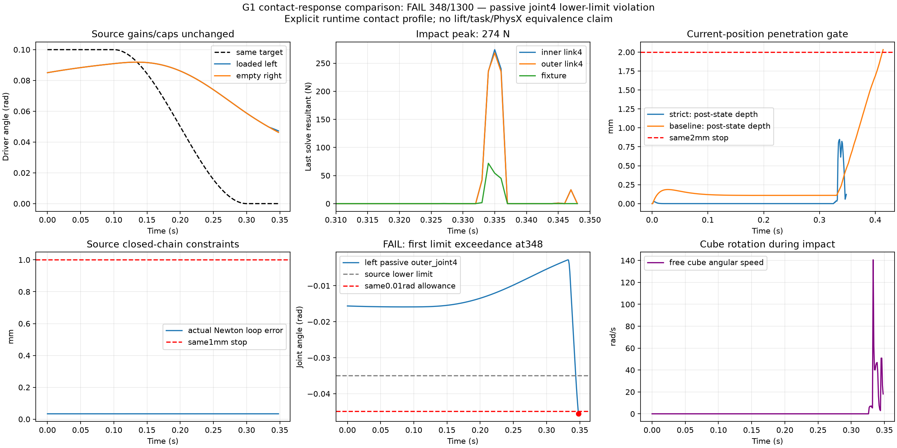

# G1 接触响应对照与 USD 接触偏移修复

本阶段分开验证两件事：完整 G1 的接触响应对照仍失败；源 USD 中已给出的接触
偏移在导入时丢失，已定位到缺省值解析。没有抓取、抬升、任务完成或三本体验收。

## 唯一一次接触响应对照

沿用[首次接触诊断](GENIESIM_POSITION_CONTROL_AND_CONTACT_20261021.md)的全 G1、
3136 个源几何、8 mm/1 g 自由块、固定校准夹具、初始状态、双驱动命令、增益、
力限、6 条等式及所有验收阈值。仍是 CPU Newton / native MuJoCo 3.13 discrete
的显式适配机构诊断，保真资格仍失败，夹具不是共享桌面任务场景。

只将左侧实际 inner/outer link4、块和夹具的 1563 个几何的接触参数设为
`solref=(.002,1)`、`solimp=(.9999,.9999,.001,.5,2)`。逐字段核对其余物理数组、
初始状态和命令不变，并在真实接触对上检查混合后的参数。这是辨别接触响应影响的
一次对照，不是测得的材料参数，不作为生产默认值，也没有继续搜索参数。

积分后穿透由生产 `CPUContactProbe.penetrations()` 查询；原始求解力另存并标记
求解时相。348 步后首次超过既有 0.01 rad 关节超限门槛，立即停止：

| 项目 | 对照结果 |
|---|---|
| 执行步数 | **348 / 1300，失败** |
| 左被动 `idx43_gripper_l_outer_joint4` 下限 | −0.0349066 rad |
| 第 347 步超限 | 0.00847122 rad，尚在停止容差内 |
| 第 348 步超限 | **0.01067734 rad > 0.01** |
| 最大积分后块穿透 | 0.847728 mm < 2 mm |
| 两指峰值接触力 | **274.139 / 268.343 N** |
| 最大支撑力 | 71.793 N |
| 连续双侧有效接触 | **5 步 < 10 步** |
| 实际 Newton 源 loop 最大残差 | 0.033809 mm < 1 mm |
| mimic 最大残差 | 6.13e−6 rad < 0.01 rad |
| 源力限超出 / 机器人碰夹具 | 均未观察到 |

更小的穿透同时伴随冲击、块旋转和被动关节越限，不能解释成接触问题已经解决。
源驱动力限没有超出也不等于接触冲击可接受。下一步须结合被动机构、接触响应和
接触后的控制行为处理，不能只增大刚度、放宽限位或改变物体质量来获得通过。

独立复核全部 349 个保存状态：初始 q/qvel、前 349 行控制向量与旧试验逐元素
相等；独立 `mj_fwdPosition` 深度与新探针记录的最大差为零；首个关节超限确为
348。离线复核没有增加物理步或重置。旧失败保留，新的失败单独发布。

还发现旧 portable XML 的 20 个 actuator 都没有名称，新位置出口按唯一完整标签
绑定时正确拒绝。此独立集成资格未通过，本次试验始终使用原已审计 direct-control
映射。不能把小模型出口测试等同于整机接入；后续导出必须保留可追溯的驱动身份。

## 源 1 mm 偏移为何变成 100 mm

G1 的 40 个 CollisionAPI prim 中，只有四个末端指面明确给出
`physxCollision:contactOffset=.001`；30 个未写，6 个为引擎缺省 `-inf`。
40 个都未写 restOffset，源单位是米。

Newton 1.6 的 PhysX resolver 要求 contactOffset 和 restOffset 都有有限 authored
值，缺一个就放弃计算 gap；随后 ShapeConfig 使用 builder 的默认 `rigid_gap=.1`。
最初 USD 导入的 native 模型已经是 100 mm，portable XML 和 RSS MJCF 只是保留它，
不是单位缩放，也不是前端显示偏移。

本机官方 PhysX `physxCollisionAPI.h` 的 restOffset 文档明确说明：缺省 `-inf`
交给引擎选择，对刚体取零。该值是引擎默认语义，不是源作者写入的数值。
小 USD 零步实验复现了缺省 rest 得 100 mm、显式 rest=0 得 1 mm、rest=.2 mm
得 gap=.8 mm、Newton 显式 gap 优先的完整 USD → native → XML → MJCF 链。

修复复用 `agent/geniesim_import.py` 的源准备与匿名 session 层：仅对可确认的刚体、
有限 contactOffset 和缺省 restOffset，解析刚体 rest=0，记录适配来源，源文件不写。
显式 Newton 覆盖和有限 PhysX rest 保留；不将其余未知 contactOffset 全局设为 1 mm。
增加 source → 每个分解 hull → native geom 的 gap/margin 资格检查，防止只检查
builder 参数而遗漏实际后端差异。非零 margin 在当前 native CCD 路径可能被置零，
应如实失败，不能仅凭 gap 正确认为全部接触语义正确。

本次接触响应对照故意没有应用这个独立修复，旧冻结 XML 和记录不变。新适配器
不会自动修复已有 portable XML；完整 G1 需要重新生成并逐 hull 核查后才可应用。
MuJoCo 的 gap 是额外检测缓冲，不是允许穿透值；修复它不能直接解释或消除之前
的 2 mm 穿透，也不能保证本次被动关节问题解决。

## 验证与证据

本机详细证据分别位于：

- `.workbench/previews/geniesim-g1-contact-response-20261021/`：冻结协议、唯一物理试验、原始力与积分后几何、独立复核及图。
- `.workbench/previews/geniesim-g1-gap-audit-20261021/`：偏移来源、官方头文件依据、五种零步复现及生产回归证据。

原始模型和大轨迹留在本机；仓库保存摘要、来源 hash 与图。Newton 1.6 对 MuJoCo
3.13 仍有依赖声明警告，本阶段不宣称普遍兼容或 GPU discrete 可用。

最终回归：MuJoCo 3.13 环境 **57 passed / 43 warnings**，既有带 USD 的 MuJoCo
3.12 环境 **57 passed / 42 warnings**。覆盖真实小 USD 导入、匿名层与源文件不变、
显式覆盖优先、每个额外 hull、单位拒绝和 native 非零 margin 丢失判定。实际 G1
仅 source/session 检查确认恰好四处适配，其余 36 处及所有源层不变；没有据此
宣称完整模型或物理任务通过。额外 G2 source/session 检查没有需要该适配的项。

速度口径：机器人标量关节峰值为 3.236278 SI/s；自由块角速度范数峰值
140.619355 rad/s，最大分量 101.126194 rad/s，后者不能写成机器人关节速度。

[默认 8765 新失败记录](http://127.0.0.1:8765/runs/48ca593b8209aeb4c373c696)单独
列出 14 项检查，其中 3 项失败（执行未完成、双侧接触持续不足、关节越限）。
源保真、控制出口资格和任务验收范围分别记录，没有重启共享服务。

页面验证：新记录 HTTP 200，预览图加载成功，“验收”页显示失败范围、三项失败
和任务未评估，无页面脚本错误。首次自动检查误用 button 选择器超时；按真实的
tab 角色选择后通过，未因此修改前端。
