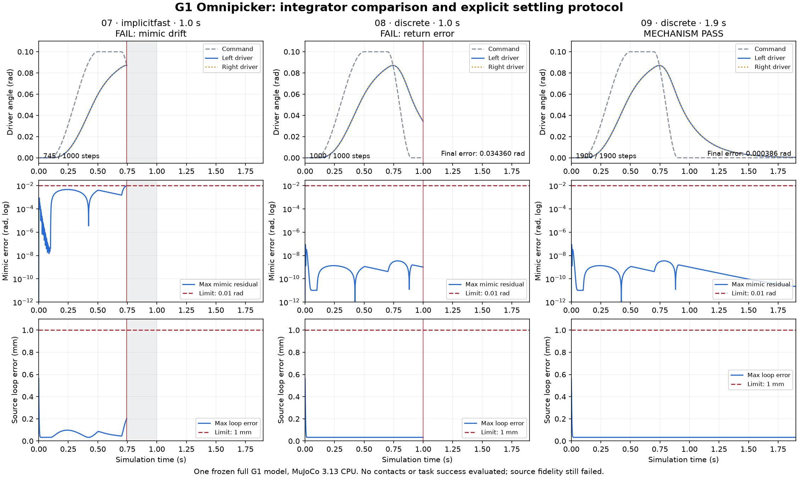
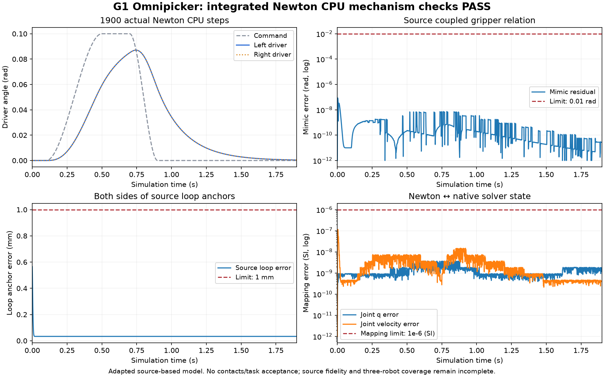

# GenieSim G1：离散动力学根因与有界验证

G1 回程的 mimic 漂移已定位到强驱动阻尼与积分器的相互作用。MuJoCo 3.13 的 `discrete` 在同一新导出 G1 模型上消除了该漂移；按源增益给出末端稳定时间后，原开合运动数值门槛通过。随后完整 G1 经生产 CPU 适配入口实际执行 Newton 1900 步，机构运动指标同样通过。两层结果分别留证；它们均不是 G2、接触抓取或任务通过，三本体 aggregate completion 仍为 **false**。

本页接续[上一轮动力学诊断](GENIESIM_GRIPPER_DIAGNOSTICS_20261021.md)。逐体重力、源锚点恢复和六条 equality 的明确诊断参数继续保留；并未改写原始导入保真失败，也不声称 PhysX 等价。

## 从已保存的 745 步定位根因

`reversal-root-cause/` 对上一轮有效 profile 06 的 native 状态做 `mj_forward` 和线性代数复核，**新增物理步数为零**，未使用最早共享视图损坏的四组历史数组。

令 `h=0.001 s`，`D=∂f_smooth/∂v`（阻尼导数为负），则逐步重建

`Δv/h = (M − hD)⁻¹ (f_actuator + f_passive + f_constraint − f_bias)`

覆盖全部 745 步、34 个坐标，最大加速度误差为 **3.64e-12**。driver 的 `kd≈1145.916`、惯量对角约 `0.001278 kg·m²`，使 `h·kd/M≈897`。约束先在 `M` 下产生的修正，在隐式阻尼后的实际速度更新中被显著抑制：

| 步 | mimic 请求加速度 | `J M⁻¹ f` | 实际 `J Δv/h` |
|---:|---:|---:|---:|
| 200 | 1080.43429 | 1080.43445 | 0.468815 |
| 700 | -376.09899 | -376.09909 | 0.038600 |
| 745 | -2621.06901 | -2621.06867 | -3.967758 |

单位为 rad/s²。重算 solver 最多用 2 次迭代，未耗尽 100 次上限；重算 actuator 力误差为零，constraint 力误差至多 5.99e-12，时间对齐也经过位置更新核验。因此这里有具体数值机制证据，不应继续仅凭“闭环较硬”猜测或盲目增加迭代次数。

16 个夹爪标量关节的局部轴映射误差至多 2.09e-10、范围误差至多 2.19e-8 rad；driver/follower 符号、零位及 `[0,-1]` 关系一致。源 angular DriveAPI 增益按每度转换为每弧度是正确的，不能通过去掉 `180/π` 来规避问题。局部 Jacobian 审查也没有证明机构锁死；这不等于源 USD 全部空间关系或 PhysX mimic 实现已经验证。

## 选择 discrete 的依据与模型身份

MuJoCo 3.13 新增 `discrete`，将约束求解和隐式速度更新合并到包含阻尼、刚度的同一有效惯量中。[官方 3.13 发布记录](https://github.com/google-deepmind/mujoco/releases/tag/3.13.0)、[版本变更说明](https://mujoco.readthedocs.io/en/latest/changelog.html#version-3-13-0-september-8-2026)。

官方计算说明使用正的阻尼/刚度矩阵，写为 `M̂=M+hD+h²K`，与上文负的力导数记号不同。此模式的 `qacc` 表示有限步速度变化率，不能直接混作旧模式连续时间加速度；这里使用 MuJoCo 的 Newton 约束求解算法，不是指 Newton 框架接入已通过；不能推定所有后端/求解器均支持。[官方 discrete 计算说明](https://mujoco.readthedocs.io/en/latest/computation/index.html#numerical-integration)。

试验放在 `.workbench/mujoco-discrete-venv` 的 MuJoCo **3.13.0** 独立环境，旧 3.12 环境保留。跨版本采用新全量导入后导出的 XML；新 CoACD 得到 **3136 geoms**，原 MJB 是 **3140**，没有手动删除 hull，但两者不能称为严格相同几何。

XML 导出还存在已量化的文本精度：质量最大绝对差 3.81e-5、惯量 2.58e-7、关节范围 3.63e-6、驱动参数 0.1875，均通过该导出的 `rtol=2e-5 / atol=1e-6` 检查。它只说明记录的数组符合导出精度，不消除凸分解差异或原有源保真缺口。07/08/09 都使用同一 `comparison_model.xml`，模型 SHA256 与原始/导出身份分别保留在[证据摘要](references/geniesim/discrete-dynamics-20261021.json)。

## 同版本对比与末端稳定时间

先做两铰链合成机制：同为 3.13、1000 步，`implicitfast` 最大 mimic 为 0.0110698 rad，`discrete` 为 2.77e-9 rad。它用于隔离积分交互，不是机器人资格验证。

完整 G1 对比保持步长 1 ms、源驱动增益和力上限、位置范围、固定基座、重力映射及六条 equality profile 一致。07 与 08 仅改变 integrator；没有接触物体。

| profile | 实际步数 | 最大 mimic | 末端误差 | 判定 |
|---|---:|---:|---:|---|
| 07：3.13 implicitfast，原 1 s 协议 | 745 | 0.010084534 rad | 回程中停止 | mimic 超过 0.01 rad，失败 |
| 08：3.13 discrete，原 1 s 协议 | 1000 | 8.62e-8 rad | 0.034359504 rad | 完成步进但超过 0.03 rad，运动验收失败 |
| 09：discrete，末端增加稳定时间 | 1900 | 8.62e-8 rad | 0.000385982 rad | 此诊断的 motion_criteria 通过 |

08 的 `status=completed` 不代表验收通过，原失败完整保留。源增益 `kd/ke=20/100=0.2 s` 给出强阻尼伺服的近似慢时间尺度；09 将回程后稳定段从 0.1 s 改为 **5τ=1 s**，总时长由 1 s 改为 1.9 s。这是明确记录的**新时序协议**，不是原 1 s 协议通过，也不是任意任务截止时间都可延长。

0–0.9 s 的原保持、0.10 rad ramp、峰值保持和回程命令均未改变，增益、限力、数值门槛也未改变。09 的实际峰值位移 0.085033939 rad > 0.05，峰值目标误差 0.014966062 rad < 0.03；最大源 loop 0.564655 mm < 1 mm，所有 equality 保持启用、状态有限、力限额未超出，接触数为零。



默认 8765 的 Studio 已分别展示 [07 回程失败](http://127.0.0.1:8765/runs/7fe34bb7111238dec6e723b2)、[08 末端跟踪失败](http://127.0.0.1:8765/runs/66049998c1b54bdfdef60f91)、[09 机构运动通过](http://127.0.0.1:8765/runs/4abd64655385b420c66d6647)。三者均保留“任务成功未评估；检查通过不代表任务完成”的范围提示，浏览器检查预览正常、无 JS 错误。09 的绿色状态仅对应其机构诊断范围。

## 正式接入边界

Newton 构建时直接传入 `mjINT_DISCRETE=4` 的尝试被其 `mujoco_warp.put_model` 拒绝（`NotImplementedError`）。正式 CPU 适配入口现复用 `agent/rss_runtime.py::build_cpu_mujoco_solver`：构建未用于 CPU 步进的 Warp 镜像时保留 `implicitfast`，随后在真正步进的 native model 显式设置 `discrete`。这没有启用 GPU discrete，没有升级旧环境，也没有改变默认积分器；qualification CLI 新增可选 `--integrator discrete`。报告保留 requested integrator，构建成功才记录 effective ID 和 MuJoCo 版本，避免把失败构建写成求解器已运行。

新增测试在 3.13 环境真实通过 Newton 执行两积分器各 1900 步，检查 mimic、5 Nm 力限与最终误差；同时核验 `notify_model_changed(ALL)` 后 native integrator 保留，以及旧版本不支持时明确拒绝。结果为 **2 passed, 4 warnings in 5.52 s**。默认 3.12 环境回归为 **32 passed, 1 skipped, 25 warnings in 4.49 s**（该回归早于后续纯报告元数据补充；元数据另做缺失源文件失败报告检查）；跳过的是已在 3.13 实际执行的 discrete 物理测试。

Newton 1.6 仍声明 MuJoCo `~=3.12.0`，实验 3.13 会产生明确依赖不匹配警告；上述有界 CPU 测试不能升级为全面兼容承诺。完整 G1 的真实集成证据如下，与小机制及 direct native 09 分开记录。

## 完整 G1 的实际 Newton CPU 验证

`newton-full/attempt03/` 通过生产 `build_cpu_mujoco_solver` 构建并调用实际 `solver.step`，每步同步 Newton state；34 nq、34 nv、6 equality、3136 geoms 均保留。该报告 scope 为 `source_based_full_G1_integrated_Newton_CPU_adapted_mechanism_diagnostic_not_task_pass`，`integrated_newton_pass=true`，但 `exact_source_qualification=failed`、`task_success_evaluated=false`。

前两次预检失败分别是 geom 名称映射和原始数组不一致，两次均 **0 个物理步**，报告原样保留。第三次 78 项预检记录仍保留 6 项 raw-array 差异；不是将它们改成相等：零质量 helper 的 COM、非唯一主惯量轴改为检查完整惯量张量与一阶质量矩，最大误差分别 5.29e-8、4.83e-8；全部 mesh 在 body frame 内的顶点集合一致。四个 CONNECT 的 parent/non-anchor 数据检查通过，child anchors 按已声明的适配显式恢复。语义预检通过不等于整个源 USD 原样无损。

| 实际 Newton 1900 步指标 | 实测 | 门槛 |
|---|---:|---:|
| 最大 mimic 残差 | 8.626923e-8 rad | 0.01 rad |
| 最大源 loop 距离 | 0.565101 mm | 1 mm |
| 峰值位移 / 峰值目标误差 | 0.085033928 / 0.014966073 rad | >0.05 / <0.03 rad |
| 最终回零误差 | 0.000385982 rad | 0.03 rad |
| Newton/native 最大 q / qd 差 | 3.71e-9 / 1.15e-7 | 各 1e-6 |
| body 位置 / 四元数分量最大差 | 8.99e-6 m / 8.72e-6 | 各 1e-5 |

所有 equality 保持启用，物理数组哈希不变、状态有限、力限未超出、接触数为零；保存 1901 个状态样本。该次运行共耗时 64.573 s，包含模型构建、预检、步进与记录，未单独测量纯步进耗时。它证明选定模型与明确适配下的 Newton CPU 机构运动路径，不证明 GPU discrete、整个版本组合全面兼容、G2 或带物体抓取通过。

从实际记录的 Newton body 状态独立计算源锚点距离，最大 **0.566971 mm < 1 mm**，与 fresh native FK 的 0.565101 mm 分开报告；该补充只测量已保存的 1901 帧，未增加物理步。六个源 USD 层的哈希仍未改变。



[完整 G1 Newton CPU 记录](http://127.0.0.1:8765/runs/7ca7eff55559ffc0489ef053)在默认端口展示 13 项检查与实际曲线；页面明确提示“G1 完整模型的 Newton CPU 夹爪机构验证；未执行接触任务”。浏览器验证预览载入正常、无 JS 错误。该页面的 passed 不改变 aggregate=false。

## 复查与显式选择

### RSS 场景构建与接触反馈

完整 G1 的上述记录对应提交 `ecc3ce5` 的 helper 实现。后续将同一实现提取为
`agent.rss_mujoco_cpu.CpuMuJoCoSolver`，继承 Newton 的原生类与 custom attribute
注册接口；原 helper 保留为延迟导入入口。`cpu_mujoco_backend()` 在 RSS 现有注册表
声明此后端的 native contact 能力，保留原 `mujoco` 后端和默认积分器。
仅给 RSS 一个裸类路径会丢失 contact routing 元信息，不能据此推定接触路径正确。

```python
from agent.rss_runtime import cpu_mujoco_backend
from agent.rss_scene import CPUContactProbe
from robosimstudio.specs import ArrangementSpec
import robosimstudio as rss

physics = ArrangementSpec(control_hz=100, substeps=10, backends=(
    ("*", cpu_mujoco_backend(integrator="discrete")),
))
scene = rss.Scene(cell="void", physics=physics)
# 在这里通过 scene.add(...) 加入已有场景/机器人实体，再构建：
sim = scene.build(device="cpu", warmup=False, use_cuda_graph=False)
sim.contacts = CPUContactProbe(sim.pipeline.solver, sim.model, sim.pipeline.sim_dt)
```

这里显式绑定已有 CPUContactProbe，与 Sharpa 执行桥一致。RSS 通用探针按标准
`mujoco` 别名寻找 solver，不会自动识别这个 opt-in 后端；调用者不可省略此步后
宣称接触验收已接入。该示例仅说明 backend/probe 接法，不是完整任务入口。

新增真实 RSS Scene 测试对 `implicitfast` 和 `discrete` 分别执行 500 个物理步：
普通 0.1 kg 球落到地面，逐体重力补偿球维持 0.2 m 高度，原生接触探针测得支撑力
在 `0.981 N ±3%` 内，默认后端声明未变。新环境合并测试 **4 passed**；
默认 3.12 环境同一场景 **1 passed / 1 skipped**，跳过 discrete；相关导入/碰撞/
solver 回归另为 **32 passed / 2 skipped**（早于接触测试扩展为两个积分器）。
首次接触测试误用了 `refresh` 方法名，物理检查已完成但探针调用失败；更正为真实
`update` 接口后通过，原失败日志保留。此小场景验证 RSS 组合与反馈边界，未重新
运行 G1，也不增加 G2 或任务通过证据。

### G1 抓取接口预检

后续离线检查使用同一份完整 G1 的 1901 帧记录、源 USD 和真实凸网格，没有增加
物理步进。两侧真实抓取接触体是 `gripper_{l/r}_{inner/outer}_link4`；夹爪基座
`+Z` 为接近方向、`Y` 为开合方向，源 TCP 在基座 `(0, 0, 0.14308)` m。
step 700 实际驱动角为 0.085034 rad，网格射线测得约 14.855–15.800 mm 开口。

复现了 RSS 接口的两个缺口，以下记录为离线预检当时的状态：

- 一驱动、一 follower 时，现有通用分支将两关节坐标差当作米；该状态返回
  `0.17006786 m`，实际返回的是弧度差。正确列出全部七个被动关节能避开此分支，
  但其后备线性估计仍不能代替真实开口标定。回程被动关节状态不同，不能据一次
  开口测量外推全行程或拟合单一线性关系。
- 成功的 MJCF 导入中 20 个驱动均为 `CTRL_DIRECT`，通用夹爪的
  `joint_target_q` 写入并不驱动这些 actuator；需要复用既有控制接口，按实际
  actuator 身份映射到 `control.mujoco.ctrl`，保留源增益、力限和单位。

8 mm 校准块是下一步接触试验的几何候选，需要真实重力和支撑、两侧指尖接触及
后续离台验收；尚无接触或抬升通过记录。源自碰撞过滤和本体保持原样。完整本机
证据在 `.workbench/previews/geniesim-g1-grasp-interface-20261021/`，本报告 JSON
保存测量、最小复现脚本及源记录的哈希。该诊断不构成 G1/G2 任务通过。

后续进展见[位置控制与首次接触诊断](GENIESIM_POSITION_CONTROL_AND_CONTACT_20261021.md)：
位置目标到源直控通道的适配已通过真实 RSS 测试，测宽/全行程标定仍未解决；
完整 G1 的首次物体接触因穿透超限失败，并发现几何门槛滞后一物理步。旧的机构
无接触通过记录不覆盖这些新失败，三本体同任务验收仍未完成。

在仓库根目录，已有 `.workbench/mujoco-discrete-venv` 可直接运行下面测试。只有重建隔离环境时才执行前两行；该环境复用本机已安装的 Newton/依赖，并在自身目录安装 3.13，不对默认环境运行 pip 升级。

```bash
.workbench/geniesim-venv/bin/python -m venv --system-site-packages .workbench/mujoco-discrete-venv
.workbench/mujoco-discrete-venv/bin/python -m pip install "mujoco==3.13.0"
.workbench/mujoco-discrete-venv/bin/python -m pytest -q tests/test_rss_cpu_solver.py tests/test_rss_cpu_backend.py
.workbench/geniesim-venv/bin/python -m pytest -q tests/test_rss_cpu_solver.py tests/test_geniesim_import.py tests/test_geniesim_collision_semantics.py
```

`--system-site-packages` 继承的是基础环境，不会带上另一个 venv 的本地 USD 包。源 USD qualifier 另需显式安装下列版本；已验证 `pxr.Usd/UsdPhysics`、`newton_usd_schemas` 导入、内存 PhysicsScene 创建和 CLI `--help`，尚未据此宣称重新完成全量 USD qualification。以下 opt-in 示例输出到新的复查目录，保留之前证据：

```bash
.workbench/mujoco-discrete-venv/bin/python -m pip install "usd-core==26.8" "newton-usd-schemas==0.6.0"
.workbench/mujoco-discrete-venv/bin/python -m agent.geniesim_import \
  --robot G1_omnipicker --assets-root GenieSimAssets/robot \
  --integrator discrete --omit-missing-camera \
  --output .workbench/previews/geniesim-discrete-recheck/G1_omnipicker.json
```

`--omit-missing-camera` 明确启用匿名 session 中对 G1 缺失装饰相机的屏蔽，源 USD 不改；必须保留该适配记录及 exact-source compose 失败，不能宣传完整源资产无损导入。G2 若复查，应改 `--robot`/输出并去掉该 G1 专用参数。qualifier 只检查导入与构建，**不执行本文的开合运动或任务验收**；现有其他来源保真失败仍可导致 exit 1。调用现有 Python 入口时显式用 `build_cpu_mujoco_solver(model, integrator="discrete")`，并使用上述隔离解释器，不改全局默认。

完整 G1 的 07/08/09 脚本、XML、轨迹当前保留在本机预览目录，尚不是独立下载即可运行的轻量回归包。仓库内的两铰链测试可复查真实 Newton/native 边界，但不替代完整机器人报告。

本阶段没有修改源机器人资产、降低数值验收门槛或开展无界参数搜索。后续仍需要 RSS 任务执行路径验证、来源保真检查、接触抓取及 G2 独立证据。

本机完整证据：`.workbench/previews/geniesim-gripper-dynamics-20261021/{reversal-root-cause,discrete-integrator}/`。摘要保存报告、脚本、协议、XML 和轨迹 SHA256，区分离线分析、合成机制、direct native 机构运动、已通过的有界 Newton CPU 机构验证与尚未完成的任务验收。
