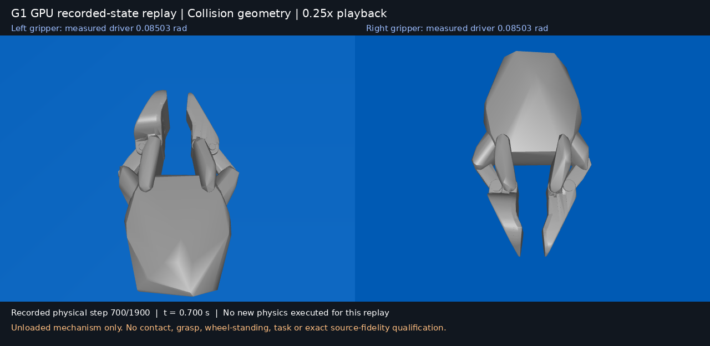
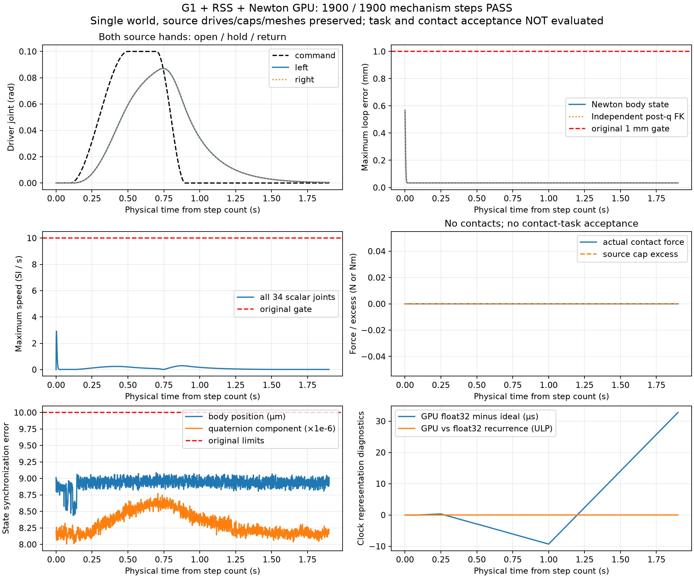

# G1 经 RSS 的 GPU 机构验证与录制态回放

实际执行链为 RSS `Scene` / 子步调度 → `PositionTargetOutlet` → Newton 1.7 `SolverMuJoCo` → MuJoCo Warp 3.15 / Warp 1.18 CUDA。此阶段的预先声明目标是**硬件导入与空载机构控制资格**，既不是保真任务重建，也不是可迁移任务生成。

原冻结协议的 1900 个 1 ms 物理子步已执行完毕，左右夹爪分别完成开、保持、回零。通过的是明确适配后的单世界空载机构；源 USD 严格等价仍失败，抓取、轮地接触、桌面任务和三本体同任务验收仍未完成。

## 实际结果与独立复核

| 指标 | 实测 | 预先门槛 |
| --- | ---: | ---: |
| 物理子步 / RSS 控制帧 | 1900 / 950 | 1900 / 950 |
| 左、右驱动峰值 | 各 0.08706 rad | 各至少 0.05 rad |
| 第 700 步保持误差 | 各约 0.01497 rad | 各不超过 0.03 rad |
| 左、右最终回零位置 | 各约 0.000386 rad | 各绝对值小于 0.03 rad |
| Newton 状态最大闭环误差 | 0.568 mm | 1 mm |
| 独立 native 当前 q 运动学闭环误差 | 0.565 mm | 1 mm |
| 34 个源标量关节最大速度 | 2.92225 SI/s | 10 SI/s |
| 源努力限幅超量 / 基座漂移 / 实际接触力 | 均 0 | 原冻结门槛 |

保存初态和全部子步，共 1901 个样本。离线检查共 19 项通过；根代理另行核对 21 个输入/证据 hash，并对全部 1901 个 q 样本进行独立运动学闭环检查，没有新增物理步。Newton q/qd 与 GPU 对应状态误差为零，body position / quaternion 分量同步误差分别为 `9.0891e-6 m` / `8.7712e-6`，均小于原 `1e-5` 门槛。

GPU float32 时钟与逐次 float32 加法完全一致，最终 `1.9000327587 s`，相对理想步数时间漂移约 32.76 µs。该表示差异独立记录，不修改步数、物理时间步或物理门槛。没有 CPU 物理回退。

## 模型范围与仍未解决的限制

- 42 个源机器人 body、34 个标量坐标、20 个驱动、6 条等式保留。3128 个源启用碰撞 geom 加 1 个明确登记的 RSS 地面；没有为使试验通过删除凸分块或机械闭环。
- 当前源启用的碰撞几何属于双夹爪组件。完整关节树不意味着全身各部位均有启用碰撞体；固定基座、重力补偿和这次空载运动不能证明车轮落地、全身碰撞或共享桌面的任务适配。回放展示的是导出的碰撞形状，不是完整 USD 视觉模型与材质。
- 源严格保真失败保留：四个闭环 child anchor 导入偏差、三个辅助 body finalize 惯量变化、两个源驱动目标越界。本次使用已记录的源双局部锚点恢复、六等式严格响应参数及重力补偿。源驱动增益、力限、关节限位与碰撞过滤不变。
- 冻结运行中实际 GPU 参数已上传、回读并确认运行前后不变；reset/notify 后的参数持久性尚未完成生产级适配。
- 这是单世界、主机同步调度的 GPU 运行。此前小模型 64 世界并行通过，不能替代真实 G1 批量任务资格。
- 没有对象或接触，不生成训练 Episode，不把缺少 G2 / YAM + Sharpa 的同任务证据计为通过。

## 工作台入口与可视化

[打开实际运行](http://127.0.0.1:8765/runs/9c8268e5ce354d38401e4ead)。复用原运行索引、媒体播放器和验收视图，不建立新接口或端口。

回放从已记录 GPU q 取每 10 步一帧，只做 MuJoCo 运动学与 EGL 渲染，不重新积分。191 帧以 25 fps 播放，相当于 0.25 倍速度；画面标注原物理步、原时间和实测驱动位置。源模型与轨迹 hash 前后不变。原始轨迹、原报告、协议、接触记录和回放 manifest 均可从本机运行产物查看。

[紧凑结果](references/geniesim/g1-gpu-mechanism-20261021/mechanism-summary.json) · [冻结协议](references/geniesim/g1-gpu-mechanism-20261021/mechanism-protocol.json) · [根代理复核](references/geniesim/g1-gpu-mechanism-20261021/root-review.json) · [回放来源](references/geniesim/g1-gpu-mechanism-20261021/replay-manifest.json)

本机完整证据：`.workbench/previews/geniesim-g1-portable-20261021/gpu/mechanism-attempt01/`；发布目录：`runs/g1_rss_gpu_mechanism_20261021/`。仓库中的脚本是原始脚本归档，需按冻结协议的原目录和已有本机资产恢复依赖，不能从 references 目录直接当作独立示例运行。大型模型、原始轨迹和视频不提交 Git。

后续工作是保持源机构与原物理门槛的接触验证。接触触发停止闭合可以作为控制方法，但不能替代双侧真实接触、持续时间、穿透与关节限位检查，更不能直接等同于抓取任务成功。

工作台已实际播放验证：HTTP 200，视频已解码并播放到 1.82 s，无浏览器错误；索引验收为 `warning`、发布资格 `not_evaluated`。验收页保留 `source_exact_fidelity` 的失败项。该项在本次**适配机构**范围之外，所以是可选项；对于严格保真重建仍是必需阻塞项，不能用本次机构通过撤销其失败。

[浏览器验证](references/geniesim/g1-gpu-mechanism-20261021/browser-verification.json) · [工作台截图](references/geniesim/g1-gpu-mechanism-20261021/studio-replay.png) · [验收页截图](references/geniesim/g1-gpu-mechanism-20261021/studio-validation.png)
