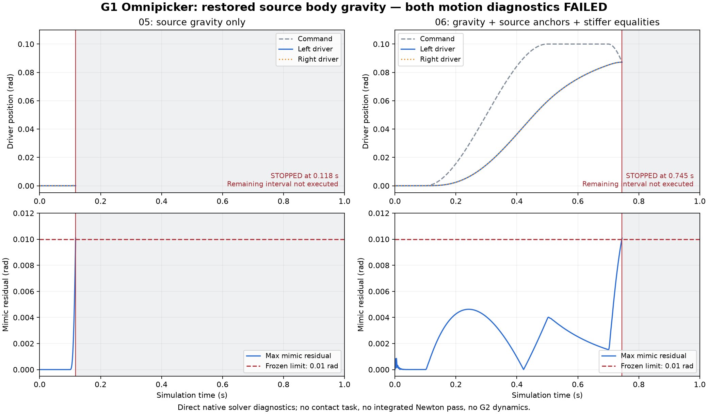

# GenieSim G1 夹爪动力学诊断：失败证据与语义差异

原始试验包含一次 G1 原始 USD 全量导入和一次 CPU `SolverMuJoCo` 动力学诊断；后续直接加载 native 模型的比较另列，不能混作这次原始试验。原报告 scope 为 `adapted_runtime_mechanism_diagnostic_not_exact_qualification_or_task_success`，`exact_source_qualification=failed`，`task_success_evaluated=false`。这不是 G1/G2 任务通过证据，三本体整体完成仍为 **false**。

后续只读审查发现关键保真缺口：源 G1 的 42 个活动刚体均明确禁用重力，G2 为 55 个禁用、base 保留；原 native model 却全部 `body_gravcomp=0`。因此原试验及前四组 native 对比承受了源没有要求的重力，不能把失败仅归因于 mimic 或关节限位的软硬，也不能称为忠实重现源模型动力学。

## 冻结协议与实际停止

导入前保存协议：1 ms 步长，计划 1,000 步；先保持测得初始姿态 0.1 s，随后平滑增加夹爪 driver 目标 0.10 rad、保持、返回。命令限制在 `[0, π/4]`。保留原碰撞几何、凸分解、固定基座、质量、驱动增益/力矩限值、关节限位，四个 CONNECT 闭环与两个 JOINT mimic 约束全程启用，没有外部对象或新增地面。

明确适配包括：沿用匿名层屏蔽缺失的装饰相机引用；观察 native finalize 的辅助刚体惯量归零；把原有越限驱动目标换成测得初始位置和有界诊断命令。原 USD 没有修改，这些适配也不能升级为原资产完全忠实导入。

| 指标 | 原始实测 |
|---|---:|
| 全量导入 / 总运行时间 | 55.560 / 93.792 s |
| native nq / nv / neq / ngeom / nu | 34 / 34 / 6 / 3140 / 20 |
| 停止步数 / 时间 | 118 / 0.118 s |
| 最大 mimic 残差 / 冻结门槛 | 0.01012720 / 0.01 rad |
| 最大源闭环锚点间距 / 门槛 | 0.566138 / 1 mm |
| 最大接触数 | 0 |

保持阶段后仅运动了 18 ms 就触发停止。此时目标约 0.000589275 rad，实际左右 driver 约 0.00001688 rad，而 follower 约 -0.0101 rad，未达到协议要求的有效开合幅度。状态/力均有限，不能因此称为动力学通过；无物体接触也不能证明抓取能力。没有降低阈值或重复全量动力学来绕过失败。

## 原录制缺陷与仍可使用的证据

原 `trajectory.npz` 的 **q、v、body_q、body_qd 不能作为历史轨迹使用**：CPU Warp `.numpy()` 返回共享视图，记录器未复制，两套 state 复用覆盖了历史值。原脚本、协议、报告和文件哈希均保留，不把后续修复当成原运行已正确录制。

native qpos/qvel/ctrl 和力数组采用显式复制，独立 driver/follower q/v 采用高级索引复制；即时计算的残差、有限性、固定基座漂移和停止判据仍有效。独立关节序列与 native 按名称对齐误差小于 4.1e-10 rad，足以确认该次失败。

`offline-audit.py` 仅加载保存的 MJB/native 状态并调用 `mj_forward`，**新增物理步数为零**。`trajectory-native-reconstructed.npz` 是推导的 native 运动学历史；body 姿态为 xyzw，速度为世界轴表达的 body 原点角速度/线速度，不能冒充原录制或 Newton 质心速度。`diagnostic-v2-safe-copy.py` 只做过语法检查，没有执行第二次全量试验。

## 已定位的约束与来源问题

原离线核验活动 angular PhysicsDriveAPI 的有限 maxForce：左右 driver 的源限值 5 Nm 与导入限值、native 总关节 `actfrcrange=[-5,5]` 一致；实测峰值 0.556930/0.556783 Nm，命令与 native ctrl 差值为零。follower 没有启用 PhysicsDriveAPI、没有 native actuator，ke/kd 和实测 actuator 力为零；遗留的非活动 `drive:*` 属性不能当成活动驱动。源 100/20 的角度增益按弧度单位转换为 5729.578/1145.916，没有手工重调。

mimic 关节映射和 `[0,-1]` 系数正确，native 残差与 follower+driver 角度和一致，表现为软约束滑移。源未显式提供 naturalFrequency/dampingRatio；native 使用默认 solref=(0.02,1)。当前不能宣称丢失了作者明确设定的弹性，也没有证据证明该默认值等价于 PhysX fallback 行为。

四个 CONNECT 的 child anchor 相对源/导入 joint_X_c 偏移 **0.56465–0.56480 mm**：backend 从参考位姿重算 child anchor，没有直接保留源值。native 初始闭环残差小于 0.34 μm，但源锚点初始已相差约 0.565 mm。这是独立的闭环坐标保真缺口，不能仅凭相关性认定它导致 mimic 失败。离线源锚点计算与即时在线值相差至多 0.217 μm。新增 `compare_ball_loop_anchors` 只审计已导入的局部锚点到 compiled model 的保留情况，不证明 USD 全部坐标轴/坐标变换都已经正确验证。

惯量来源复核：G1 三个、G2 七个无几何辅助 frame 的 mass 没有作者值，不能称为“作者设为零质量”；其约 1e-4 对角惯量有作者值，native finalize 按有效零质量归零。原始惯量保真失败保留；G1 的两个原始越限 target 也未被抹去。

## 回归与后续状态

来源元数据、力矩上限及 ball-loop child-anchor 审计的局部回归记录为 **27 passed, 20 warnings in 4.76 s**；警告来自 USD 弃用接口。这证明检查器测试通过，不会把上述实际失败改写为机器人通过。

前四组 MJB-only 对比复用保存的 native 模型和初始状态，没有重新全量导入：

| 适配配置 | 停止步数 | 触发失败 |
|---|---:|---|
| 原模型重放 | 118 | mimic 0.0101272 rad > 0.01 |
| 恢复四个源 child anchors | 118 | mimic 0.0100901 rad > 0.01 |
| 恢复 anchors，仅收紧两条 mimic | 135 | 源 loop 1.013534 mm > 1 mm；mimic 0.00201891 rad |
| 恢复 anchors，收紧全部六条约束 | 195 | idx01 线性关节低于下限 0.01001959 m > 0.01 m |

重放与原有效 native qpos/qvel 差约 7.12e-10 / 8.29e-8，低于冻结 1e-5 容差。

四组都未通过。第四组的 idx01 是 prismatic，范围 `[0,0.55]` m；源 linear DriveAPI maxForce=100 N 与 native ±100 N 一致。原协议通用标量阈值的 `_rad` 后缀对该关节具有误导性，实际比较的仍是原数值 0.01 m，没有改变停止门槛。补充类型感知审计覆盖 1 个 linear 和 19 个 angular 活动驱动，增益及力上限均匹配。该 native 初始静态重力负载为 177.222 N；这不是源禁用重力模型的真实负载。严格 profile 使用 solref=(0.002,1)、solimp=(0.9999,0.9999,0.001,0.5,2)，不降低验收门槛。这些都是直接 native 求解器的诊断 profile，不是集成 Newton 通过或 PhysX 等价声明。即使完成开合，仍须独立判断来源语义、接触与任务验收。

发现重力差异后，原拟议的限位硬化试验已取消，未执行。现有接入在编译前通过匿名 session 将作者明确的逐体禁用重力映射为 `mjc:gravcomp`，不改源文件，保留全局重力使外部对象仍受重力。真实 100 步双自由体“悬停/下落”及冲突拒绝测试纳入当前回归：**31 passed, 24 warnings in 5.26 s**。最初直接改 MJB gravcomp 而未刷新 `ngravcomp=0` 缓存的尝试已标为无效，不能用于结论。修正比较通过 `mj_setConst` 刷新为 42，并在其重算 CONNECT 锚点后恢复该 profile 约定的 equality 数组；数组哈希核验通过。初始静态 bias 与补偿力相差至多 1.14e-13。

| 恢复源逐体重力后的配置 | 停止步数 | 触发失败 |
|---|---:|---|
| 05：原 anchors / 原 equality 参数 | 118 | mimic 0.01008516 rad > 0.01 |
| 06：源 anchors / 全部六条 strict equality | 745 | 回程 mimic 0.01008452 rad > 0.01 |

06 在 0.700 s 的 driver 位置为 0.08516874 rad：已超过 0.05 rad 幅度要求，与 0.10 rad 目标误差小于 0.03 rad；但 0.745 s 回程触发原门槛，**完整往返仍失败**。源 loop 最大 0.564654 mm，未超过 1 mm；没有接触、非有限状态或力上限超限。躯干位移小于 0.214 μm，而未恢复重力的 04 下沉约 10.020 mm；这支持重力语义丢失导致躯干问题，不能据此宣称其余约束问题已解决。两次修正比较共 863 个物理步，保持原 joint-limit 参数和全部验收门槛，未继续盲目加硬或搜索参数。

## 最终全量导入复查

随后通过正式接入重新导入 G1/G2，报告 scope 为 `embodiment_import_qualification`，两者均 `status=failed`、CLI exit 1、`task_success_evaluated=false`。这次全量导入与前述 MJB-only 比较分别留证，没有把后者冒充正式动力学验收。

| 本体 | 19 项检查：通过 / 失败 / 跳过 | 逐体重力 | 耗时 |
|---|---|---|---:|
| G1 Omnipicker | 14 / 4 / 1 | 42 个源禁用体均 gravcomp=1，通过 | 105.919 s |
| G2 Omnipicker | 16 / 2 / 1 | 55 个禁用体为 1，base 为 0，通过 | 144.850 s |

两者仍失败于 finalized 惯量保真和 native ball-loop anchor 保留；G1 另有原始相机引用无法完整 compose、原始 drive target 越限。剩余物理资格检查均跳过。源入口与所用层哈希保持不变。记录位于 `.workbench/previews/geniesim-gravity-import-20261021/{G1,G2}_omnipicker.json`。逐体重力缺口已在导入阶段修复并通过检查；完整夹爪往返、接触抓取及三本体任务验收尚未通过。

原始证据位于 `.workbench/previews/geniesim-gripper-dynamics-20261021/`。[紧凑摘要与哈希](references/geniesim/gripper-diagnostics-20261021.json)保留原报告 scope、脚本/协议/原始与推导轨迹哈希、源文件快照、运行依赖版本及回归日志哈希。Newton 1.6.0、Warp 1.18.0、MuJoCo 3.12.0、USD 26.8、newton-usd-schemas 0.6.0 是本次报告记录的版本；源码哈希区分原试验快照与后续检查器修改。

## Studio 展示与复查入口

默认 8765 保持统一入口。新增两份全量导入报告保持原文件哈希；动力学页面使用原生报告的明确失败检查，并链接原始报告、协议和已复制的有效轨迹。没有将这些记录包装成成功 Episode。

- [G1 导入检查](http://127.0.0.1:8765/runs/16bd3d9972aed9f19f212856?view=validation)
- [G2 导入检查](http://127.0.0.1:8765/runs/3e54369aa47ee38cb2912421?view=validation)
- [G1 动力学曲线](http://127.0.0.1:8765/runs/9337f56258636fe4b07af420)

Playwright 实测三页均为失败，显示正确检查范围及“任务成功未评估”；G1/G2 显示逐体重力检查通过，曲线图片实际加载为 2080 × 1216，无页面脚本错误。图中灰色区间未执行，不能延长曲线推断往返成功。



可复查的正式导入与回归命令（重新导入仍预期 exit 1，不代表命令崩溃）：

```bash
.workbench/geniesim-venv/bin/python -m agent.geniesim_import --robot G1_omnipicker --omit-missing-camera --output /tmp/g1-import-review.json
.workbench/geniesim-venv/bin/python -m agent.geniesim_import --robot G2_omnipicker --output /tmp/g2-import-review.json
.workbench/geniesim-venv/bin/python -m pytest tests/test_geniesim_import.py tests/test_geniesim_collision_semantics.py -q
```
