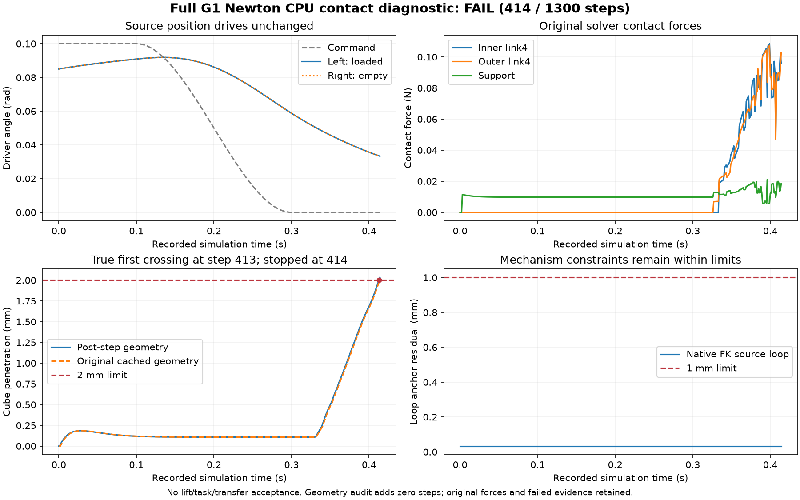

# G1 位置控制接入与首次物体接触诊断

位置目标到原生驱动通道的适配已在真实 RSS 场景测试通过。完整 G1 的独立接触
诊断在第 414 步因物体穿透超限停止：双侧接触存在，诊断仍不通过。两项证据范围
不同，本轮没有抓取、抬升、任务完成或三本体同任务通过。

## 保留源驱动，接通 RSS 目标

`agent/rss_position_targets.py` 的 `CpuPositionTargetOutlet` 复用 RSS 的 `pre_solve`
钩子。它将明确选中的 `joint_target_q` 位置目标复制到导入模型的
`control.mujoco.ctrl`，不改 source actuator 类型、增益、力限、约束或其他控制通道。

构造时只接受单世界 CPU、单位传动比、无 activation dynamics、零参考偏置的标量
位置伺服：`kp * (target - q) - kd * qd`。motor、速度驱动、tendon、D6、同关节
多驱动及非零参考不在支持范围，拒绝把这些通道当位置伺服使用。控制必须给出有限、
符合源 actuator 控制范围的值；错误输入在写入前整体拒绝，不静默裁剪。

映射使用 Newton 已有的 solver 表：native actuator → native joint → Newton joint
→ `model.joint_target_q_start`；控制槽使用 `mjc_actuator_to_newton_idx`。完整
actuator label 和源 DOF 映射交叉验证身份。含 FREE/ball 时，q 与 qd 的索引不能
混用；不能依赖某次导入的固定数字，也不能用机器人名称替代控制语义。

```python
from agent.rss_position_targets import CpuPositionTargetOutlet

# sim 为已有 RSS Scene 构建结果；按资产身份明确选择完整标签。
selected_labels = [...]  # 来自 sim.model.mujoco.actuator_label
outlet = CpuPositionTargetOutlet(sim.model, sim.pipeline.solver, selected_labels)
sim.pipeline.hooks.add(
    "pre_solve", lambda _state, _dt: outlet.apply(sim.control),
    name="imported_position_targets",
)
```

每个 Scene 安装一次，在首次 reset/warmup 前安装；重建模型或改变驱动语义时重建
outlet。既有 Action/IK/Gripper 仍写原目标数组，独立 motor 通道由原控制器负责。
当前 RSS 的 `Scene.build(warmup=False)` 只跳过构建末尾立即 reset，返回的
`sim.warmup` 仍默认为 True；严格无 warmup 协议还需明确 `sim.warmup = False`。
审查时两个小场景的 reset 各隐式推进 0.020 s，已记录，不能称为零步进审查。

测试构造一个自由物体在前、hinge/slide/motor 在后、actuator 顺序相反的真实场景：
目标槽为 7/8，DOF 槽为 6/7，控制槽为 2/1。未装 outlet 时位置目标不影响直控
伺服；安装后分别达到 0.2 rad 和 0.012 m，独立 motor 保持 0.125。每个积分器
实际执行 1010 步（含安装前的 10 步对照），源驱动和限位数组不变。

隔离 MuJoCo 3.13 环境的控制、CPU 后端、机构、导入和碰撞回归原为 **38 passed**；
加入下述积分后几何回归后，最终合计 **39 passed**。
默认 Workbench 3.12 环境 **19 passed / 19 skipped**：跳过项包括无 discrete 支持
及该轻量环境缺少 USD 依赖；这些检查已在上述带 USD 的 3.13 环境实际执行。
首轮控制测试在构造阶段失败，原因是 NumPy 标量与 MuJoCo 枚举的比较；改为显式
整数枚举后通过，失败日志保留。测试 MJCF 同时明确声明了弧度单位。

这只证明该控制适配器的边界，不证明完整 G1 已经通过这个 outlet 执行任务。
目前 G1 通用夹爪 `width()` 的角度/距离混用和全行程标定仍未解决，不能凭新的
控制通道启用未经验证的抓取宽度规划。

## 完整 G1 首次物体接触

这是机构接触诊断，不是可迁移任务或精确保真任务。继承先前完整 G1 的 3136 个
源几何、34 个 native 标量自由度、20 个源驱动、6 条约束以及明确声明的重力和
双锚点适配。源资产不改，精确保真资格仍为 failed。使用旧的已审计 direct-control
映射执行；本节物理运行没有使用新 outlet，不能将两项测试合并宣传。

增加 8 mm、1 g、保留重力的自由校准块，摩擦 `(1, .005, .0001)`；在源左夹爪
TCP 放置。外部固定校准夹具为 3×6×4 mm，有真实碰撞，初始支撑间隙 10 µm。
它不是共享桌面任务环境。机器人全部标量 q/qvel 从此前记录 step 700 按身份恢复，
不宣称加速度或 warmstart 连续。全局重力保留，42 个源机器人刚体按 authored
逐体重力语义处理，新增块不补偿重力。

协议在步进前冻结：1 ms 步长，0.1 s 保持 0.1 rad，0.2 s 平滑闭合至零，1 s
停稳，最多 1300 步。保持先前 mimic 0.01 rad、loop 1 mm、速度、限位、源力限
和基座稳定门槛；另声明物体穿透 2 mm、位移 20 mm 和机器人不得碰夹具的停止条件。

前三次构建/预检均为零步进，原报告保留：新增 primitive 的隐式 gap、inactive
字段与无几何 exclusion 差异、1 g 的浮点精确相等判断、正间距零力候选误判接触。
分别修正显式输入、物理等价检查及判定逻辑后才进入第四次尝试。源机器人参数和
接触停止阈值不变；无力 proximity 候选不计作实际接触。

第四次是唯一实际接触运行，记录 415 个状态、414 个物理步：

| 检查 | 实际结果 |
|---|---|
| 双侧真实 link4 同时接触 | 连续 81 步；存在接触 |
| 两侧峰值接触力 | 0.108522 / 0.107423 N |
| 停止时缓存穿透 / 积分后真实几何穿透 | **2.005165 / 2.032381 mm，均 > 2 mm** |
| 最大块位移 | 0.327408 mm |
| 机器人碰夹具 / 块碰其他机器人部位 | 均未观察到 |
| 最大 mimic / 实际 Newton 源 loop 残差 | 7.43e-9 rad / 0.033809 mm |
| 力限超出 / 非有限状态 | 均未观察到 |
| 接触诊断 / 抓取及任务验收 | **失败 / 未评估** |

停止原因是穿透，不能因为双侧接触或机构约束稳定而通过，也不能增加穿透容差
来获得成功。后续需要基于实际接触参数、法向与力分析原因，再做有依据的修正。
未进行参数搜索，G2 与 YAM+Sharpa 的同任务验收仍不能由这份 G1 证据替代。

### 离线复核：接触几何有一物理步的时序偏差

对全部 415 个保存状态在独立 `MjData` 中执行 `mj_forward`，不增加物理步进、不
替换原始求解力。发现 `mj_step` 返回的 `d.contact.dist` 对应积分前接触缓存，
保存的 qpos 则已是积分后状态。实际第 **413 步**的穿透已达 **2.005164 mm**；
第 412 步为 1.981251 mm；第 414 步最大为 **2.032381 mm**。缓存门槛在 414
步才读到，因此本次停止晚了一物理步。原始报告不改，补充报告明确时间含义。
相邻缓存与重新计算几何的最大差约 2.97e-8 m，支持这一时序判断。

已修正生产 `agent/rss_scene.py` 的 `CPUContactProbe.penetrations()`：在独立
`MjData` 内执行 `mj_fwdPosition`，返回当前积分后状态的真实穿透；不替换原始
接触力缓存、不推进时间、不修改步进数据或 warmstart。既有 CPU 抓取、候选场景
和 SimFoundry 场景检查调用同一接口，因此直接使用修正后的几何查询。GPU 探针
未改，历史 G1 失败记录不重写；尚未重新执行完整 G1。

新增真实物理回归使球在 1 ms 内从地面上方跨入 1 mm 穿透：旧接触缓存无重叠，
新接口检测到 1 mm，并验证原状态、求解力、接触缓存和 warmstart 数组完全不变。
原始接触力仍保留其实际求解时间，不能用离线 forward 力冒充原来的求解力。

新增块的质量和惯量符合 1 g、8 mm 均匀立方体。默认接触参数为
`solref=(.02,1)`、`solimp=(.9,.95,.001,.5,2)`，尚未证明与源 PhysX 接触等效。
持续闭合时两侧仅约 0.1 N，带物体左驱动与空载右驱动在停止时只相差
7.58e-7 rad，说明接触反力几乎未改变闭合运动。该证据指向接触响应与驱动配合
的验证工作，不能直接推出某组新的刚度就是正确真值。

原 USD 手指 authored contactOffset 约 1 mm，中间模型的检测 gap 为 100 mm；
这项独立保真差异产生大量无力候选，仍需修正。MuJoCo 3.13 的 gap 是额外检测
范围，实测 active 接触的 includemargin 为零；它不能直接解释 2 mm 穿透。

本机完整证据：`.workbench/previews/geniesim-g1-contact-20261021/`；控制测试日志
为 `/tmp/rss-position-targets-{tests,tests-02,default,integrated}.log`。版本组合仍有
Newton 1.6 对 MuJoCo 3.13 的依赖声明警告，只能报告本次 CPU 路径已测范围。

最终回归日志为 `/tmp/rss-position-contact-final-tests.log`；默认环境的积分后几何
单项 **1 passed**，结果保存在 `/tmp/rss-post-step-geometry-default.log`。



[8765 工作台记录](http://127.0.0.1:8765/runs/fc5239b52bc8dcab1285f95a)的“验收”页
显示诊断范围、未评估任务成功及三项失败检查；图片加载和页面脚本已实测。

后续进展见[接触响应对照与 USD 偏移修复](GENIESIM_CONTACT_RESPONSE_AND_OFFSETS_20261021.md)：
更硬接触的单次试验因被动关节越限失败；1 mm 源偏移被回退为 100 mm 的导入原因
已修复并测试。两项证据分开，原始失败不变，旧 portable 模型尚未重新生成。
