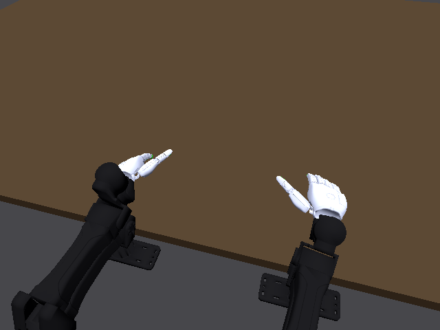

# Newton 1.7 接入现有 RSS 执行入口

本阶段将前次独立 GPU 运行时验证接到现有 CLI、工作台 worker 和运行环境检查。
默认 RSS 解释器配置为 `.workbench/venvs/newton-1.7-gpu/bin/python`；感知、Stage 3/4
和重新规划继续使用原 `environments.pipeline`。这不是所有机器人任务已通过的声明。

## 已实现

- `agent/rss_runtime.py::rss_python` 统一选择 RSS 解释器。CLI、工作台 RSS 启动、
  候选场景检查和环境探测共用它；两个虚拟环境即使指向同一个基础 Python，也不会
  被错误地视为相同环境。
  旧配置若显式指定 pipeline、未写 RSS 解释器，仍使用原 pipeline；只覆盖任务参数
  的配置继承新版默认。已修复全局新默认意外覆盖旧解释器选择的问题。
- 现有位置目标出口扩展为 `PositionTargetOutlet`，支持单 world 的 CPU / GPU。
  保留原 CPU 入口；精确解析驱动标签、joint/DOF/target 索引和单位，拒绝 motor、
  非单位 gear、非零参考位置、无效目标及越界目标。GPU 的真实伺服参数必须与
  native 构造快照一致；其他直接控制通道保持不变。
- 此出口需要主机校验与同步，尚非批量 CUDA graph 控制器。前次 64 world 验证
  证明的是 Newton 原生批量能力，不能据此宣称完整 G1 已实现批量控制。
- RSS 的自定义重力从标量改为沿 up-vector 的三维向量，适配 Newton 1.7 API。
  依赖声明与 uv override 同时对齐 Newton 1.7 / MuJoCo 3.15，避免只改一个版本号。

上游源码仍基于 `73739abe212f963e8a9f5862b27bca370df091a7`，本地修改以
[`robosimstudio-newton-1.7.patch`](../patches/robosimstudio-newton-1.7.patch) 保存。
未向上游仓库推送，也未改动 SimFoundry 复现工作。

## 安装

在上述 RSS commit 的干净 checkout 上应用一次补丁，再安装：

```bash
git -C robosimstudio apply ../patches/robosimstudio-newton-1.7.patch
uv venv --python /data/miniconda3/envs/dexagent/bin/python .workbench/venvs/newton-1.7-gpu
uv pip install --python .workbench/venvs/newton-1.7-gpu/bin/python -r requirements-newton-gpu.txt
uv pip check --python .workbench/venvs/newton-1.7-gpu/bin/python
```

本机环境已存在，不重复创建。现已安装 RSS、PyRoKi/JAX、Viser、录制与视频解码依赖，
154 个已安装包的依赖检查通过；[完整环境快照](references/newton/rss-runtime-requirements-20261021.txt)
包含验证用 pytest。根目录 `requirements-robosimstudio.txt` 保留原混合感知环境安装方案，
本次 GPU 环境使用独立的 `requirements-newton-gpu.txt`。

## 实际验证

| 检查 | 结果与范围 |
|---|---|
| 新环境控制出口、重力与导出 | 23 passed，包含 implicitfast/discrete 两次真实 GPU 伺服执行 |
| 旧环境相同回归 | 20 passed、3 skipped；GPU 测试未启用，旧版本没有 discrete |
| 解释器路由、配置继承、实际 worker 与环境 API | 34 passed；原配置脚本回归同样通过 |
| RSS 场景组合、请求、fleet 伺服契约及录制时钟 | 50 passed、10 subtests passed |
| 既有 CLI rigid | 150 帧；落地、有限状态、录制、时钟全部必需检查通过；未请求渲染 |
| 既有 CLI sharpa / GPU | 625 帧、2.5 s；34/37 检查通过，其余是两项警告和一项非任务范围跳过 |

Sharpa 保持原 I2RT YAM + Sharpa Wave 模型与控制映射。最大手臂跟踪误差
0.013043 rad、手指误差 0.009855 rad、末态误差 0.000281 rad，均在原门槛内。
源求解器适配警告保留。独立闭环 CPU 对照最大误差约 5.14e-6 rad；无反馈的
开环力矩回放误差约 0.210 rad，仍报告 warning，不能把二者混成同一种控制语义。
已渲染并解码视频；这是自由空间动作验证，抓取任务没有因此通过。

[工作台 Sharpa 记录](http://127.0.0.1:8765/runs/287d91de6f0a658773bf1fe7)、
[刚体记录](http://127.0.0.1:8765/runs/5966e769061ef8ce8b414b06)、
[结构化检查与哈希](references/newton/rss-runtime-20261021.json)。



## 尚未完成

完整 G1 的 GPU 模型与控制预检正在继续，源保真差异、此前接触失败均保留。
G1、G2、YAM + Sharpa 的同任务验收仍未完成，不发布为已通过的训练数据。
现有 faithful / candidate / grasp 等路径仍按各任务配置选择物理设备；选择新版
解释器不等于将所有路径静默改为 GPU。尚需完成 GPU 接触任务回归及默认设备迁移。
