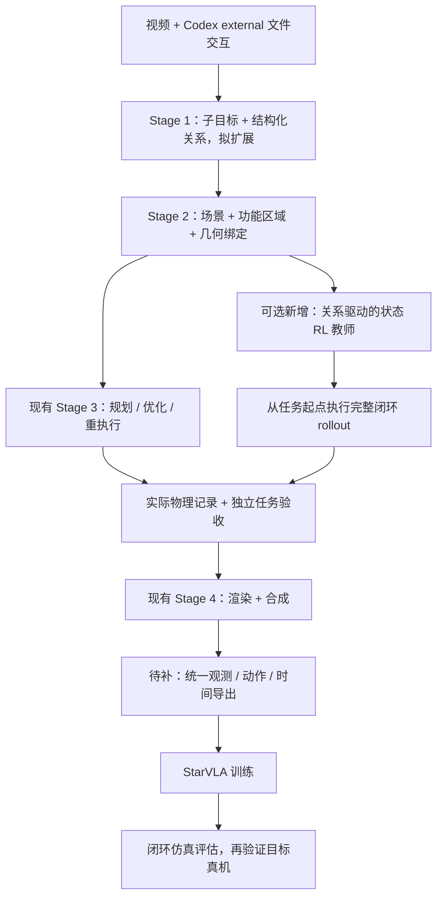

# 当前流程复查与 Dex-One2Many 整合建议

日期：2026-10-13。范围：当前代码、已有运行产物、用户提供的论文正文及官方论文附录。本轮完成审查和设计，未实现新的 RL 算法、重新训练策略或进行真机实验。

## 1. 结论

可以吸收，优先吸收三项：**结构化任务关系、满足关系且能继续执行的初始状态、多种与整项任务兼容的抓法**。它们能改善当前随机化主要围绕一条参考轨迹、一个抓法变化的限制。

建议保留 DexAgent 的语义理解、场景重建、工具库、独立任务门禁、物理记录和 Stage 4 渲染，逐步增加关系驱动的数据生成。先把数据发布和训练接口补完整，再考虑引入状态 PPO 教师，生成更丰富的闭环示范供 StarVLA 学习。

论文主方法使用物体位姿等状态输入及任务空间控制。把它接入视觉策略训练，需要增加观测、动作和时间对齐的导出环节。论文提供跨本体的方法，实验中各本体分别训练策略；不能据此推断已经有一个通用多本体 VLA。[论文实验与附录](https://arxiv.org/html/2610.12470v1#S4.SS3)

## 2. 本轮核验了什么

### 2.1 现有证据及其范围

| 证据 | 核验结果 | 能支持的结论 |
|---|---|---|
| `runs/e2e_validation_20261013/outputs/run_report.json` | `pipeline_eval`，Stage 4 五步均 `passed` | 已有一次实际 Stage 4 小样本验证 |
| 同目录 `randomize.json` | 新布局目标 1，尝试 2，接受 1；另保留原始样本 | 验证了原轨迹和一个新布局的物理回放，样本量不足以估计泛化 |
| 同目录 `reports/plate.json` | `segmentation_backend=user_masks`，LaMa 补全 | 这次运行未重新验证 SAM3-LiteText 的分割表现 |
| `samples/0000/trajectory.npz` | `qpos=(472,70)`、`qvel=(472,68)`、`ctrl=(472,56)`、`reference=(472,70)`；这些数组均为有限值 | 已有真实状态、控制及参考记录，不能说“没有轨迹或动作” |
| 同一 NPZ | `time_s` 长度 472，`substep_ctrl=(7850,56)`；源轨迹 30 Hz，末时间 15.7 s | 可以追溯物理积分与控制过程 |
| `samples/0000/composite.json` | 472 个轨迹帧对应 16 个图像帧、1 Hz，最后图像源索引 450 | 当前视频属于稀疏验证输出，尚需定义正式训练采样规则 |
| `runs/e2e_top_smoke_final_20261013/run_summary.json` | `smoke/scope_completed`，Stage 1–3 复用，`full_pipeline_complete=false` | 不能用它证明一次不复用的全流程已完成 |
| 材质预览 | 当前 `yam_black` 已改为石墨灰；旧批量产物仍含原黑色材质 | 预览改善已经发生，旧批量视频尚未代表新配置 |

已检查报告、映射、数组维度及有限性，并审查缓存和发布代码路径；没有启动新一轮生成。现有记录尚不能证明完整的“新视频 → 新分割/重建 → 新轨迹 → 训练数据 → 策略训练 → 闭环任务评估”链路。

### 2.2 已确认的工程问题

| 优先级 | 问题与证据 | 改进及验收 |
|---|---|---|
| P1 | **材质修改没有使旧报告失效。** `export.py:26` 从模块目录读取 `materials.json`，`reporting.py:66` 的输入身份未收集它。用现有产物恢复报告环境后重算身份，仍匹配旧身份；export/render/composite 仍可被判定可复用。旧场景 base 是 `[0.01,0.01,0.011]`，当前是 `[0.08,0.09,0.105]`。 | 每步指纹包含实际代码、配置、模型和内部资源；材质变更使 export→render→composite 及相关审批失效。测试必须使用真实内容变更，而非只改文件名。 |
| P1 | **发布审批与顶层摘要没有收敛路径。** 顶层 `run_dexagent.py:195` 每次启动全部 Stage 4；每步重跑产生新 attempt，下游和旧审批失效。单独审批只更新 Stage 4 报告，顶层的阶段报告和总摘要仍为旧快照。 | 增加不生成新产物或 attempt 的 finalize/revalidate 路径，核验同一运行的输入、产物、依赖和审批后重建顶层状态；保留 Stage 1–3 证据，不把局部运行升级为全流程，不抹除失败。重复 finalize 幂等，相关产物变更仍阻断发布。 |
| P2 | **待审发布仍可能被自动化当成成功。** 顶层已经有 `release_review_pending`，但 `ok` 和退出码只判断请求范围是否执行完成。 | 分开表达生成完成、请求范围完成和发布就绪；正式发布入口仅在 `release_ready=true` 时返回发布成功。保留普通生成命令的明确语义。 |
| P1 | **训练动作契约尚未纳入发布门禁。** 生成时已检查控制记录；最终 randomize 验证主要检查 qpos/names/labels/fps，composite 主要检查视频及整数索引映射。 | 导出器验证动作来源、单位、顺序、控制频率、因果时间对应、终止状态及相机同步；通过真实训练加载器读取后判定训练接口验收通过，学习价值仍需闭环策略评估。 |

缓存优化应沿现有 `DEPENDENCIES` 实现每步身份，避免一次渲染材质变化连带重跑昂贵的物理随机化和背景板生成。不要再增加一套平行的缓存/报告框架。

### 2.3 需要实验检验的算法与视觉问题

**参考朝向可能过度限制任务。** 杯子 Stage 1 的要求是直立放进碗里、释放、碗不动；Stage 3 manifest 还含完整目标四元数。`outcome.py:239` 用固定 15° 误差验收。一次布局仅因 `at_target_orientation` 失败：误差 17.07°，位置误差 9.7 mm，末端倾斜 0°，手接触 0，支撑接触 80。该记录提示完整朝向可能过严，但尚未对这个拒绝样本独立复核全部 Stage 1 关系，不能直接宣布它成功。

改进应由任务决定朝向约束：直立、轴向对齐、离散对称或完整姿态。插接、工具工作面等任务仍可能需要严格姿态。保留跟踪误差作为诊断指标，只有任务明确要求的姿态才作为任务成功门禁。

**样本多样性主要是局部布局变化。** 当前 `randomize.py` 采样对象 dx/dy/yaw 与机器人关节初态扰动，再适配参考轨迹，失败时可重执行。它有价值，但不能据样本数量推断抓法、恢复行为或任务策略已经多样化。需分别统计布局覆盖、抓法种类、接触模式、轨迹差异和完整任务成功率。

**背景板限制了新视角的真实性。** 当前 ego 视角用二维干净背景板；其他视角将它按桌面平面重投影，视野外填房间色。缺少真实的三维背景、遮挡及视差。固定 ego 可继续作为基线；新腕部视角应做相机范围和背景有效覆盖检查，必要时重建/布置三维背景，或单独标注其合成方式。材质看起来更好不能证明策略更容易迁移。

**仿真通过尚未验证真实控制系统。** 默认运行本体为双 YAM + Sharpa，记录包含 12 个机械臂力矩控制和 44 个手指位置控制。`setup/setup.yaml` 已注明力矩界限为 SDK 编码范围、armature 为仿真估计。后续需要针对目标硬件验证安装、惯量、控制响应、摩擦、延迟和相机标定。训练另一个本体时，应重新生成或适配并验证该本体的示范。

## 3. Dex-One2Many 中哪些可以复用

用户提供的正文支持以下方法要点：按关系变化划分阶段；从图构造观测、奖励和各阶段初始状态；使用多指抓法并保存闭手命令；以物理筛查剔除无效状态；对质量、摩擦、位姿误差及延迟做随机化；状态策略通过低层控制执行。

| 论文思想 | 当前基础 | 建议整合位置 | 工作量 |
|---|---|---|---|
| 阶段关系图 | Stage 1 有顺序子目标、对象/部件引用、自然语言成功条件 | 把结构化关系作为 Stage 1 的正式输出，声明 schema，绑定 Stage 2 的对象/部件几何 | 小到中 |
| 关系级验收 | `task_gates.py` 已支持 held、inside_container、contact、release_settle、relative_pose 等 | 复用谓词及测量，不另建第三套成功规则 | 小 |
| 多阶段、可继续执行的 reset | 当前只对整段轨迹初始布局随机化 | 独立 reset 池，检查碰撞、稳定、可达性及下一阶段连接 | 中到大 |
| 多种功能抓法 | 已有抓取搜索和可选抓取先验 | 搜索时加入功能区域与后续任务兼容性；保存抓法及闭手命令 | 中到大 |
| 关系驱动 RL | 现有 PPO 为参考轨迹残差跟踪 | 新增可选状态教师；复用 rollout/物理记录，重建观测、奖励、动作和 reset | 大 |
| 状态教师生成视觉示范 | Stage 4 已能渲染物理 episode | 教师完整闭环 rollout → 同一物理记录 → Stage 4 → 统一训练导出 | 中，依赖数据契约 |
| 感知/控制误差随机化 | 当前布局随机化及物理回放 | 教师训练与闭环评估加入动力学和延迟扰动，保存每个 episode 的实际参数 | 中到大 |

现有 `reinforcement_learning_tracking.py` 的目标是跟踪已给定参考；`sampling_mpc_refinement.py` 也是局部残差优化。复用其工程骨架时，须明确新教师的任务奖励和状态分布，不能把旧技能改名就算复现论文。

官方附录给出了反向构造相邻阶段状态、跨阶段抓法兼容性筛查，以及 Isaac Lab/PhysX 下 49,152 个并行环境的训练配置。各阶段状态满足关系只是筛选的起点，我们仍应验证连接动作能执行。完整复现需要单独评估仿真与计算资源。[论文附录 C.3–C.5](https://arxiv.org/html/2610.12470v1#A3.SS3)

截至本轮查询，官方项目页的代码入口仍标为 Coming soon，当前可以独立实现小型原型，尚不能声称已直接集成作者代码。[官方项目页](https://dex-one2many.github.io/)

## 4. 建议的组合流程

Codex 继续负责语义提取、程序构造、报告解读和修复；运行时控制由策略和低层控制器完成。保留 `agent.provider=external` 的文件请求/响应流程，不引入模型 API。环境、权重缓存和新训练输出继续放 `/data`。

### 4.1 最小关系表示：沿用已有谓词

`task_gates.py:2610` 已解析 `goal_predicates`，`stage1_goal_report` 已读取 Stage 1 的该字段，`task_success_report` 已读取 `task_success_predicates`。Stage 1 schema 尚未正式声明这些字段。优先补齐声明、对象绑定和阶段组织，避免再创建等价的谓词解释器。

当前显式谓词是追加检查，不能替代 `goal/task_success` 的自然语言完整覆盖；`compile_final` 对未支持的语义仍会阻断验收。初版需同步检查文本与结构化关系的一致性。若以后让审定的 Stage 1 结构化关系成为主要成功标准，应单独迁移独立验证契约，不能让 Stage 3 自填谓词绕过它。

杯子任务可组织为以下阶段约束；这是设计示例，尚未写入现有产物：

| 阶段 | 应满足的关系 | 仍可变化的内容 |
|---|---|---|
| 抓取并抬起 | `held(hand,cup)`、`lift_clearance(cup,table)` | 可用抓法、接近方向、抬起路径 |
| 移至碗上方 | `held(hand,cup)`、杯子位于碗接收区域上方 | 合理的位置与路径 |
| 放下并释放 | `inside_container(cup,bowl)`、直立的 `release_settle(cup)` | 任务不要求的杯子偏航 |
| 持续要求 | 碗相对本 episode 初始状态不移动 | 不同 episode 可有不同初始布局 |

需要明确关系的有效阶段和持续时间：释放后不再要求 held；历史上成立过的关系不应一律永久保持。`pre_grasp/pre_inside` 等接近标记可以辅助训练，不能作为最终成功的替代条件。

关系、阈值和证据在 Stage 1/2 审定并固定哈希；Stage 3 的规划器或 RL 教师可以改变执行方法，不能通过修改目标来使自己通过。奖励可以复用几何测量，但最终验收仍由独立门禁执行。

### 4.2 先验证候选状态和抓法，再扩张数据

首个实验继续使用杯子入碗、左手执行，固定右手；避免同时引入新本体、新任务和新控制接口。

1. 给现有成功布局和抓法建立基线，记录成功/拒绝原因及生成成本。
2. 在功能区域内生成不同抓法；保存抓法来源、手指闭合目标、接触信息和物理参数。只保存接触后的实际 qpos 不足以恢复闭手作用。
3. 对每个抓法检查完整任务兼容性：抓稳、可搬运、可放入、不被碗边挡住、可释放。
4. 如加入中间阶段 reset，从后向前保持目标区域与抓法的一致性；复用完整状态记录，保存速度、执行器/控制器状态、机构状态、物理参数及阶段标识，恢复后检查 IK、碰撞、稳定及连接动作，不能只保存 qpos。
5. 中间 reset 可用于训练和诊断。正式数据及主成功率仍要求从任务起点完成；阶段片段必须单独标记，不能冒充完整任务。
6. 所有接受的示范记录实际控制下的状态变化，并通过原有独立物理与任务门禁。

质量、摩擦等由 Codex 或类别经验给出的数值只作为参数先验，注明估计来源；不能当作硬件实测。扰动范围需有依据，并测试边界条件，避免只在一个猜测的物理模型下筛出“稳定”抓法。

SAM3-LiteText 可以继续做分割基线。吸收关系方法不必先恢复受限 SAM 3.1；功能区域分割是否够用，需要在固定帧、提示词及人工标注上比较漏检、误检、边界和稳定性。缺少区域证据时，应明确失败或待复核，不能静默把整个物体当作可抓区域。

### 4.3 状态教师作为可选扩展

教师观测使用任务相关几何/位姿和本体状态，奖励使用关系进展及仍须保持的条件，训练状态覆盖不同阶段。首先验证小规模闭环学习是否优于当前规划基线，再选择和隔离 GPU 仿真后端。

教师须记录实际阶段切换，为独立门禁生成对应的 Stage 1 子目标映射和阶段帧窗口；不能沿用参考轨迹的帧边界。Stage 4 的适配入口渲染已经验收的教师物理记录。若进行轨迹变形或重执行，应记为新的 episode，重新验收；不能把其通过当成原教师的闭环成功。

部署形式需要在项目内选定：采用与真实控制器一致的关节目标，或新增任务空间动作及 QP 低层。两者会产生不同的动作契约，不应混用。若更换仿真引擎，还需重新验证接触、惯量、控制频率和终态门禁，不能只转换 XML/URDF 就沿用旧通过结论。

论文中双 RGB-D 位姿估计和 QP 属于其迁移方案；当前视觉 VLA 路线仍需独立验证部署时能获得哪些观测，以及策略到真实控制器的接口。[论文 §3.3](https://arxiv.org/html/2610.12470v1#S3.SS3)

## 5. 先补齐训练数据契约

| 字段/规则 | 要求 |
|---|---|
| 来源 | `source_demo_id`、布局/抓法 id、任务图哈希、实际场景及物理参数、生成器/教师版本 |
| 本体 | 固定 `embodiment_id`、关节/执行器名称及顺序、安装与相机标定版本 |
| 观测 | 每相机 RGB、时间戳、源物理帧索引；机器人本体状态按名称提取 |
| 动作 | 明确是关节位置目标、速度、力矩还是任务空间命令；保存单位、坐标系、频率和低层版本 |
| 因果对齐 | 明确图像/状态在施加哪段控制之前采集，以及动作对应的时间区间；不要未经检查直接把同索引 ctrl 当作训练标签 |
| 片段与终止 | `stage_id`、关系标签、成功/失败、终止原因、完整或阶段片段、末帧和稳定窗口 |
| 可追溯性 | 图像、轨迹、动作、配置、场景和模型指纹；导出后再次校验 |

当前样本的 70 维 qpos 包含物体坐标，不能全部作为机器人状态/动作。默认物理机器人有 56 个关节，但不同动作定义的维度仍需单独确定。ctrl 混合机械臂力矩和手指位置目标；reference、实际 qpos 和 ctrl 各有用途，需要选择与部署控制器一致的训练标签。

`export_policy_trajectory.py` 已能按关节名提取和重采样轨迹，可复用这部分；仍需增加控制标签、图像时序、episode/task 元数据和 LeRobot 导出。第一版正式发布建议 `render.stride=1`。降采样时统一定义图像与动作的采样窗口，并保留所需终态证据；不能仅追加一张末帧却继续声称均匀帧率。

训练划分按原始演示、场景和对象实例分组，同源随机化样本不能散落在训练集与测试集。物体真值可用于教师及评估；是否作为部署策略输入取决于真实感知系统。StarVLA 必须使用与本体匹配的动作头、相机槽位和归一化统计，不能直接套用 G1 配置。

## 6. 每一步如何得到反馈

沿用现有逐步 JSON、终端反馈和总摘要，在对应步骤增加检查。下面是待实施的验收要求，不代表本轮已经通过。

| 环节 | 必需检查 | 指标与证据 |
|---|---|---|
| 语义/关系提取 | schema、对象引用、关系可测量、阶段顺序、持续要求 | 每条关系的原视频证据、覆盖/未支持项 |
| 场景/功能区域 | 几何绑定、尺度、碰撞几何、相机、区域有效性 | 投影图、部件可视化；有标注时报告误差 |
| reset/抓法 | 碰撞、稳定、可达性、任务兼容性、闭手命令完整 | 按阶段/抓法的接受率、拒绝原因、耗时 |
| 教师或规划器 | 从任务起点闭环执行，完整物理记录，独立终态验收 | 成功率、完成时间、失败阶段、滑落/接触/控制界限 |
| 渲染/合成 | 所有视角可解码、有效覆盖、图像—轨迹映射和终态保留 | 抽帧及完整视频；无可靠阈值的观感项保留复核状态 |
| 训练导出 | state/action 单位、顺序、时序、终止、元数据、分组划分 | 用实际 LeRobot/StarVLA loader 读入；回查随机样本 |
| 策略评估 | 固定测试集合，从起点执行，不以视频观感作成功条件 | 分条件成功率、试验数和置信区间、失败视频 |
| 目标硬件 | 观测与控制接口一致、标定及控制参数有证据 | 仿真/真机同任务结果及具体差距 |

比较顺序：A 当前布局随机化；B 加结构化关系和任务相关姿态约束；C 加多抓法与阶段 reset；D 加状态 RL 教师。使用相同任务、测试初态、数据预算和部署观测，另外报告生成/训练计算成本。分开评价未见布局、抓法变化、物理参数变化和视觉变化；分开报告数据生成接受率与训练后策略成功率。

先用少量固定种子验证检查逻辑，再扩大独立测试集。一个新布局通过不足以说明泛化；中间 reset 成功率不能替代完整任务成功率。

## 7. 推荐实施顺序与代码精简原则

1. **先修现有工程闭环：**每步代码/材质/模型指纹；审批后 finalize 并刷新摘要；明确发布门禁；补齐数据时序和动作契约。对材质变更、审批、坏控制数组、缺末帧、错误时间映射做小型回归。
2. **再做关系目标实验：**正式声明已有 Stage 1 predicates；复用 `task_gates.py` 测量；按任务审查完整姿态约束；保持严格的独立目标验收。
3. **增加任务兼容的多抓法：**复用现有抓取与重执行工具，验证能否提升有效布局覆盖和训练后成功率。
4. **最后试状态 RL 教师：**在独立可选模块里实现，沿用 episode 记录、报告和 Stage 4 接口；证明收益后再扩展任务、本体和 GPU 规模。

精简方式：保留一套谓词定义、一份实际物理记录、一套报告状态和依赖图、一份训练数据契约。报告负责展示检查结果，算法负责生成，导出器负责做格式与语义转换。避免重复实现成功判断或把全部训练逻辑塞进 `randomize.py`。

当前值得推进的是“关系目标约束 + 物理有效的多样示范 + 可训练数据 + 闭环策略评估”。工程门禁修复与论文方法实验有清楚的先后依赖；外观预览和单次物理通过继续作为其中的证据。

## 8. 入口索引

- Stage 1 schema：`stage1_semantic_understanding/schema.json`
- 已有谓词及独立目标验收：`tool_library/common/task_gates.py:2564`、`:2610`、`:3026`、`:3134`
- 完整朝向验收：`tool_library/common/outcome.py:232`
- 现有参考跟踪 PPO：`tool_library/skills/reinforcement_learning_tracking.py`
- MPC 残差优化：`tool_library/skills/sampling_mpc_refinement.py`
- 随机化与物理交付：`stage4_robot_data_generation/stage4/randomize.py:870`
- 输入身份及依赖：`stage4_robot_data_generation/stage4/reporting.py`
- 材质、背景重投影与帧映射：`stage4_robot_data_generation/stage4/export.py:26`、`:281`、`:436`
- Stage 4 验证/审批：`stage4_robot_data_generation/run_stage4.py:168`、`:615`、`:634`
- 顶层发布状态：`run_dexagent.py:725`
- 已有轨迹导出工具：`tool_library/skills/export_policy_trajectory.py`
- 物理本体与控制约束：`setup/setup.yaml:73`
- 用户提供正文：[附件](/home/taizun/.codex/attachments/581180ad-d8cf-4f33-877d-11d26184d5d4/已粘贴的文本.txt)
- 官方完整论文：[arXiv v1](https://arxiv.org/html/2610.12470v1)
