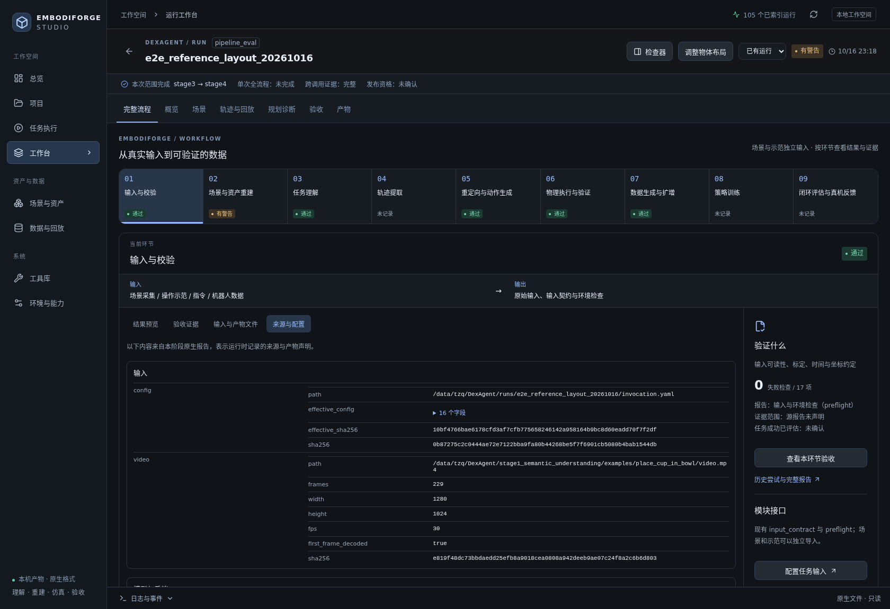
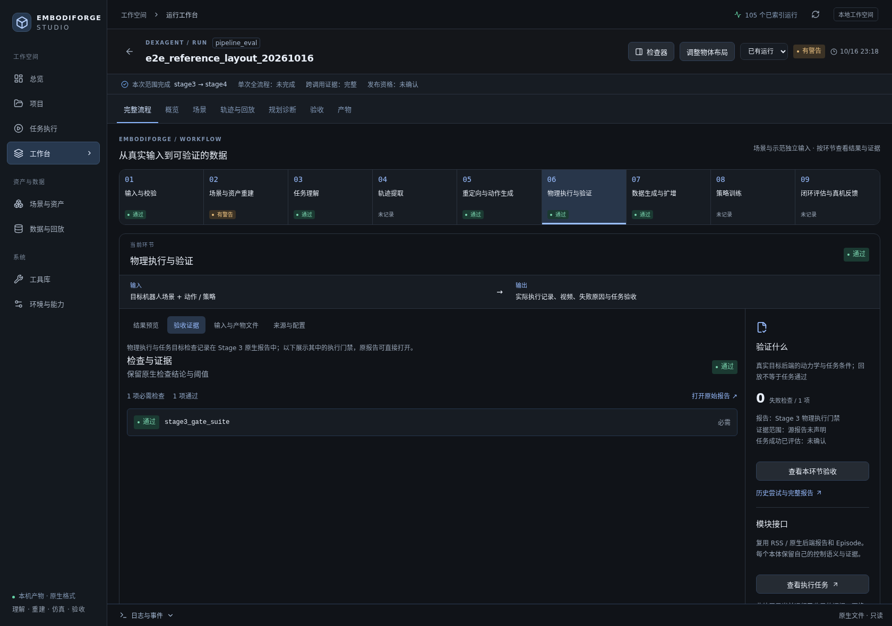
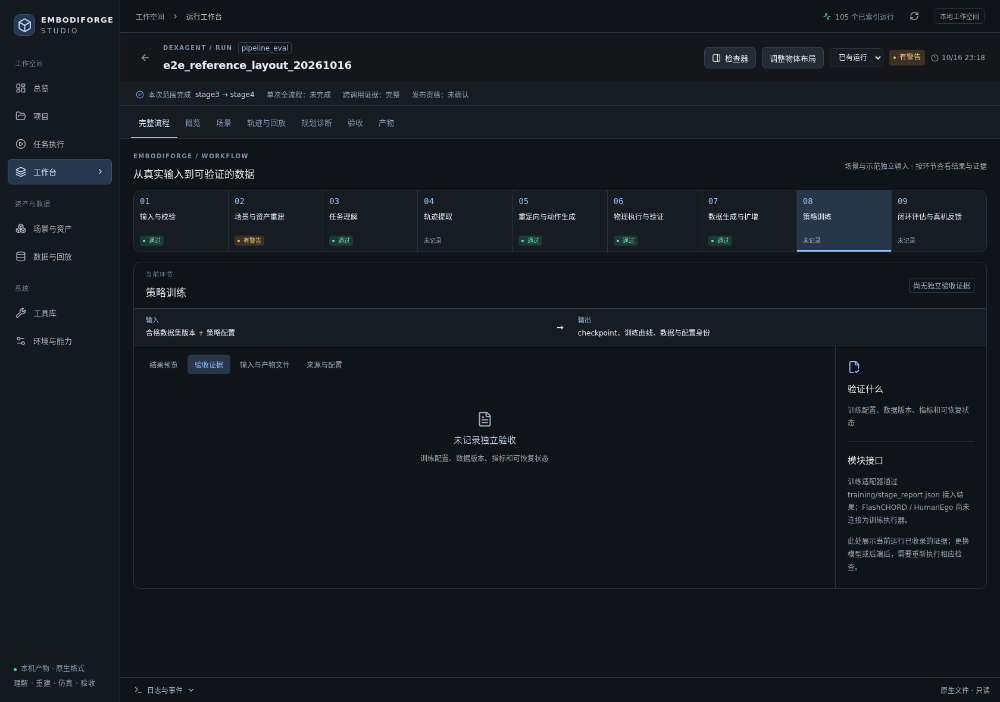
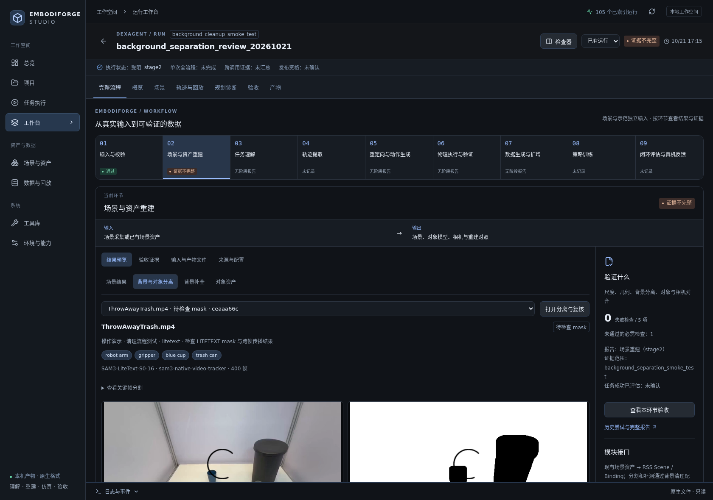

# EmbodiForge 全流程输入输出核验

核验日期：2026-10-21。范围是 Workbench 默认运行工作台中的 9 个流程环节、现存 DexAgent 原生报告、单独的背景分离冒烟运行，以及最近一次通过工作台创建的 pipeline 执行。

## 结论

目前能够从真实运行证据连续核对到 Stage 4 数据生成。最完整的案例是 2026-10-16 的“蓝杯放入绿碗”：Stage 1–2 在首次调用生成，Stage 3 失败修正后与 Stage 4 在恢复调用生成；不是一次无恢复冷启动，原生 `run_summary.json` 也正确保持 `full_pipeline_complete=false`。该案例使用 I2RT YAM + Sharpa Wave，任务模式没有记录，因此只作为历史单本体管线证据，不作为 Faithful Real2Sim 或 Transferable 任务验收。

策略训练和策略闭环评估没有本案例的阶段报告。2026-10-21 最近一次新建的 `pipeline_eval` 执行在预检查阶段失败：配置输入仍是占位路径 `/data/tzq/DexAgent/path/to/human_video.mp4`，Stage 1–4 未启动。这是当前实际入口状态，不能用 10 月 16 日的旧报告覆盖。当前全流程尚未完成。

## 九个环节的输入、输出与当前证据

| 环节 | 输入 | 输出 / 验收证据 | 本次核验结果 |
| --- | --- | --- | --- |
| 1. 输入与校验 | 视频、任务指令、运行配置、设备/模型环境 | 输入视频身份、元数据、可读性和运行环境预检 | 10 月 16 日案例 17 项预检通过；10 月 21 日最新 pipeline 因占位视频不存在而失败。 |
| 2. 场景与资产重建 | 场景扫描视频或已有场景资产；前景对象线索 | 场景几何、对象资产、相机/坐标信息、重建报告 | 历史场景重建为 warning：杯/碗投影 IoU 为 0.771/0.846，但可达性见证不充分，且有 98 条绝对网格路径。背景清理有独立入口，当前 ThrowAwayTrash 冒烟运行只到 mask 人工复核。 |
| 3. 任务理解 | 视频/演示或自然语言任务 | 对象、初始/目标状态、子目标和成功条件 | 历史案例理解为“把蓝杯放进绿碗”，生成 3 个子目标，Stage 1 的 5 项检查通过。 |
| 4. 轨迹提取 | 操作演示及时间戳/相机线索 | 人类手部/物体参考轨迹、阶段和时间映射 | 没有独立 `trajectory extraction` 阶段报告。历史运行的轨迹与子目标打包在 Stage 3 的 `trajectory_manifest.json` 中，UI 不应显示成独立阶段已验收。 |
| 5. 重定向与动作生成 | 任务约束、参考轨迹、目标机器人映射 | 机器人动作/关节轨迹、映射和规划诊断 | 历史 Stage 3 生成 3 个子目标的机器人动作；当前主流程把生成与执行放在同一个 Stage 3 原生报告里。 |
| 6. 物理执行与验证 | 场景、机器人、动作和物理参数 | 执行视频、接触/动力学记录、子目标及物理门禁 | 历史 Stage 3 的 `stage3_gate_suite` 和 `task_goal_report` 通过；执行证据嵌在 Stage 3，而非独立 `execution/stage_report.json`。Workbench 已改为在第 6 环节读取并展示这组原生门禁。运行级 `task_success_evaluated` 字段仍未明确确认。 |
| 7. 数据生成与扩增 | 通过物理验证的 episode、场景和随机化配置 | 随机布局回放、场景导出、渲染视频和合成 episode | 历史 Stage 4 的 `randomize / plate / export / render / composite` 五步均通过；请求并接受了 1 个随机样本，原始布局也有物理回放。 |
| 8. 策略训练 | 合格 episode、数据集版本、策略配置 | checkpoint、训练曲线、配置身份和训练报告 | 本案例没有训练报告或 checkpoint 证据；Workbench 正确显示“未记录独立验收”。 |
| 9. 闭环评估与真机反馈 | 策略 checkpoint、目标仿真/真机、评测任务 | 闭环成功率、失败分类和反馈修正 | 本案例没有闭环策略评估或真机反馈报告；Workbench 正确显示未记录。 |

阶段 4 的历史验收只证明该单样本数据扩增流程的五个子步骤通过，不代表策略训练、策略部署或真机闭环完成。

## 运行证据

### 历史 Stage 1–4 案例

- Workbench 运行：[`e2e_reference_layout_20261016`](http://127.0.0.1:8765/runs/20fa33af189e626f743f7afd?view=workflow)。
- 输入：`stage1_semantic_understanding/examples/place_cup_in_bowl/video.mp4`，229 帧，30 fps，7.633 秒，1280×1024；SHA-256 `e819f48dc73bbdaedd25efb8a9018cea0808a942deeb9ae07c24f8a2c6b6d803`。
- 指令：`Put the blue cup into the green bowl.` 场景内杯和碗为操作对象，视频相机标定是显式输入；此次运行未从单目视频独立估计度量尺度或完整相机轨迹。
- Stage 1：5/5 检查通过；输出 3 个可测子目标。
- Stage 2：场景对象与几何检查有 warning。重建 manifest 报告杯、碗 IoU 分别为 0.771、0.846；通用采样未产生抓取可达见证，这表示尚未证实，不等于证明不可达。场景包含 98 个本机绝对网格路径。
- Stage 3：恢复执行 3 个子目标，原生物理门禁及任务目标报告通过，并产出仿真视频和 `trajectory_manifest.json`。第一次 Stage 3 曾因目标朝向误差失败，失败记录保留在历史尝试中。
- Stage 4：随机化、背景板、导出、渲染和合成五步全部通过；一个随机布局被接受，原始布局亦回放。输出包括 episode、场景/变换导出、渲染帧和合成视频。
- 运行恢复关系：Stage 1–2 来自首次调用；Stage 3–4 来自修复后的恢复调用；另有一次只修正合成视觉的调用。`pipeline_validation.json` 汇总了可追溯证据，原生 `run_summary.json` 仍表示恢复调用只请求 Stage 3–4，`full_pipeline_complete=false`。
- 机器人：使用 `setup/setup.yaml` 标识的 I2RT YAM + Sharpa Wave。没有 G1 Omnipicker、G2 Omnipicker 对同一任务的物理执行证据；没有可用于三本体 Transferable 任务验收的结果。

历史阶段报告与文件：

- [Stage 1 report](../runs/e2e_reference_layout_20261016/stage1/stage_report.json)
- [Stage 2 report](../runs/e2e_reference_layout_20261016/stage2/stage_report.json)
- [Stage 3 report](../runs/e2e_reference_layout_20261016/stage3/stage_report.json)
- [trajectory manifest](../runs/e2e_reference_layout_20261016/stage3/trajectory_manifest.json)
- [Stage 4 report](../runs/e2e_reference_layout_20261016/stage3/stage4_task/outputs/run_report.json)
- [cross-invocation validation manifest](../runs/e2e_reference_layout_20261016/pipeline_validation.json)
- [native invocation summary](../runs/e2e_reference_layout_20261016/run_summary.json)
- 详细历史说明：[FULL_PIPELINE_VALIDATION_20261016.md](FULL_PIPELINE_VALIDATION_20261016.md)

### 当前背景分离冒烟运行

运行 [`background_separation_review_20261021`](http://127.0.0.1:8765/runs/f4d03b51ffa44c467ffca78b?view=workflow&phase=scene&sceneStep=separation)。输入是用户指定的 `ThrowAwayTrash.mp4`，用于冒烟检查；分割采用 SAM3-LiteText-SO-16 和原生视频跟踪器。运行报告记录 mask 输出和共享帧时钟检查通过，但 `human_mask_review` 与 `scene_scan_reconstruction` 均为 skipped，任务处于 blocked/incomplete。当前没有经过人工确认的对象 mask、补洞后的背景板或清理后场景重建产物。

这项工作属于“场景与资产重建”里的背景/操作对象分离子流程。扫描视频和操作演示仍是不同输入，不能把此分离冒烟运行并入蓝杯/绿碗案例。

### 最近一次新建的 pipeline 执行

运行 ID `340a519c93c077a8bf63947d`，Workbench execution ID `ae3dfbe7cd384a61b58d6d53`，profile `pipeline_eval`。17 项环境/模型检查大多通过，但 `input_video_readable` 检查失败：`inputs.video` 指向不存在的占位文件 `/data/tzq/DexAgent/path/to/human_video.mp4`。Stage 1–4 仅生成了未执行的占位阶段报告，没有开始视频理解或物理仿真。不能将它算作管线实跑。

用户截图中的 [`g1_rss_gpu_mechanism_20261021`](http://127.0.0.1:8765/runs/9c8268e5ce354d38401e4ead) 是另一种运行：它完成了 1,900 个 G1 GPU 机构步骤，但报告明确标注“非抓取任务”；接触/抓取/任务和轮地/全身碰撞检查均为 skipped，源保真检查失败。它只验证后端机构，不能填充视频输入、重建、任务理解或动作生成等环节。

## 界面调整与观察

Workbench 的阶段详情现在按原生报告显示输入、模型/后端、配置身份及产物声明；运行声明信息按来源原样展示，敏感字段会脱敏。第 6 环节可以关联 Stage 3 中的物理门禁和执行媒体，但仍会保留其真实报告来源。背景分离入口位于“场景与资产 → 场景重建 → 背景与对象分离”。

## 验证与未完成项

- Workbench 后端报告/清理回归：28 项通过。
- 前端 workflow 页面 Playwright：4 项通过，含历史运行第 6 环节证据和背景分离入口。
- 前端生产构建通过；Vite 有现存大 chunk 提示。
- 未重新运行耗时的 Stage 1–4 物理数据生成；本报告不把历史报告称为本日冷启动实跑。
- 当前 pipeline 配置仍需提供真实输入视频。新任务运行前必须明确任务目标与模式；若声明 Transferable，须对同一任务在 I2RT YAM + Sharpa Wave、G1 Omnipicker、G2 Omnipicker 上分别执行并验证，任何缺失都不能汇总通过。
- 阶段 8/9 尚未接入这条案例的训练与闭环产物；下次应将 dataset identity、训练配置/checkpoint、评估输入与闭环门禁作为真实阶段报告接入，不能用 episode 导出代替训练或评估。
