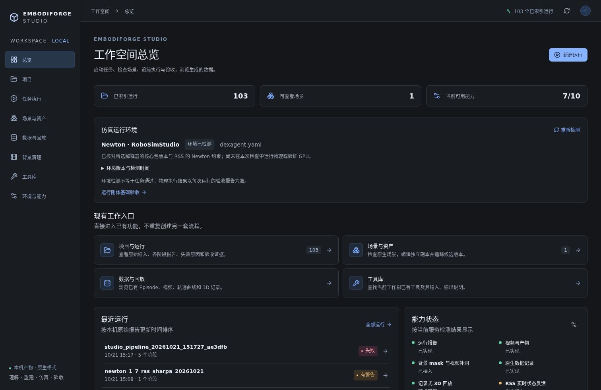
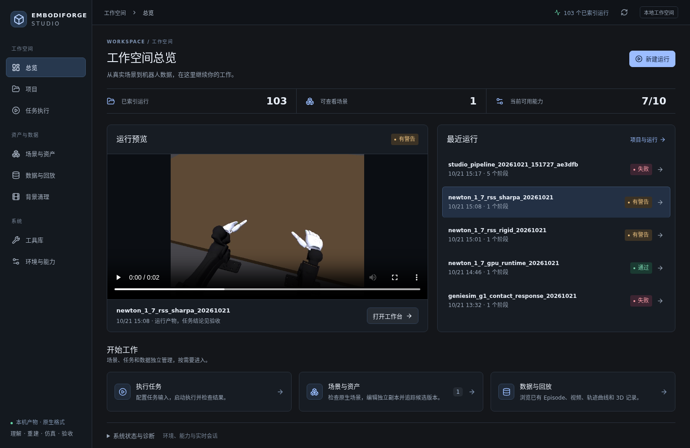
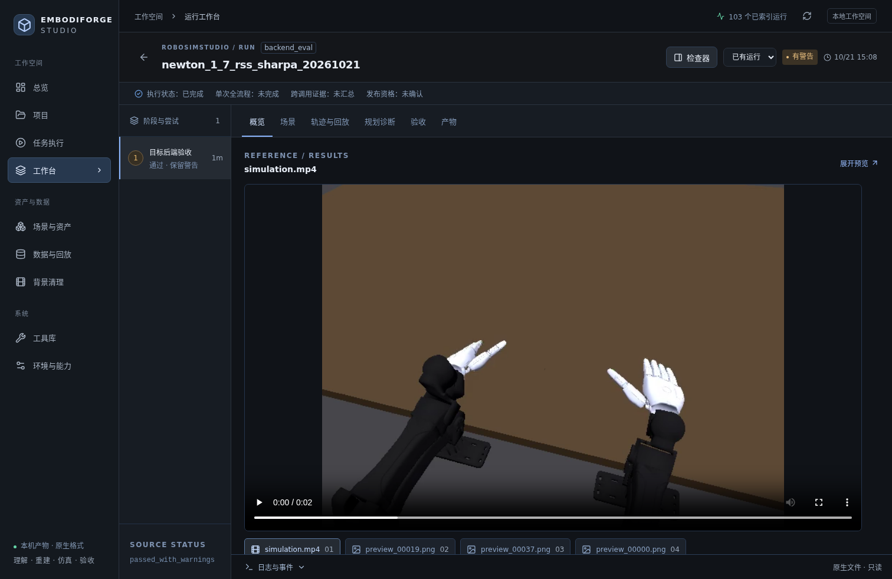
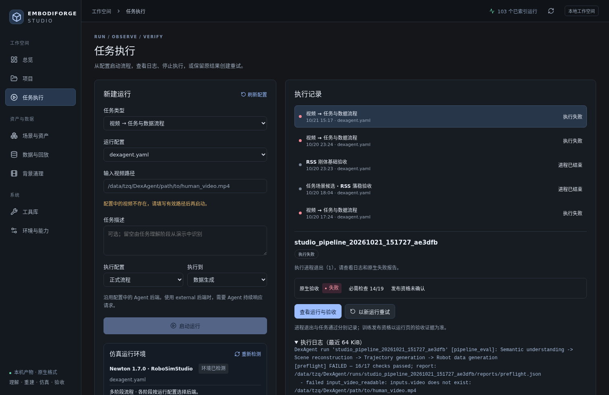

# EmbodiForge Studio 界面整理 · 2026-10-21

本轮针对用户反馈“界面很乱、看不出更新”，直接检查 8765 的首页、任务执行、运行工作台和场景页截图后调整信息层级。复用现有 API、媒体播放器、编辑器和验收视图，未改变物理执行与任务通过标准。

## 界面变化

- 主导航分成工作空间、资产与数据、系统三个分组，保留既有 URL。
- 首页首屏展示真实运行媒体和最近五条运行。默认预览其中最近有媒体的一条，失败记录仍显示在原时间顺序中；可以手动选择任意运行。没有媒体、报告读取失败、视频解码失败分别显示对应状态，不能残留其他运行的视频或结论。
- 首页的环境版本、能力清单与 RSS 实时诊断归入“系统状态与诊断”，默认收起；完整运行环境也可从“环境与能力”打开。保留状态、CPU/GPU 区分与未验证边界。
- 执行页先完成任务输入、配置并启动；运行环境说明移到表单之后。进程状态、原生验收、重试与日志保持可访问。
- 运行工作台的检查器默认收起，给视频和三维内容更多空间；右上角“检查器”按钮在桌面和窄屏均可打开证据面板。验收标签始终可用。
- 场景页的路径和完整 SHA-256 收入“场景来源与版本”；独立副本编辑、候选版本与来源绑定逻辑保持原样。
- 统一背景、导航、字号和间距。媒体使用现有播放器，保留播放位置恢复、解码错误提示和原文件下载。

## 实际验证

- `npm run build --prefix workbench/frontend` 成功。原有 ECharts 分包体积警告仍在，没有为消除提示修改构建阈值。
- Playwright 定向回归：**14 通过，1 跳过**。覆盖首页入口/编辑会话恢复、实时状态展示契约、环境切换/错误恢复、Agent 等待、真实报告/播放/失败验收、键盘导航、窄屏和新增预览身份隔离/检查器操作。跳过项需要真实连接的 RSS live 会话，当前未连接；不算通过。
- 直接访问原 8765：五个页面均 HTTP 200；1512px 桌面与 390px 窄屏检查均无文档横向溢出，无 JS 页面错误。读取并查看了实际截图；运行媒体等待解码后截图。
- 原服务热读取新构建文件，无需重启，没有关闭场景编辑会话或仿真 worker。

测试命令：

```bash
cd workbench/frontend
npx playwright test e2e/simulation-runtime.spec.ts e2e/workspace-layout.spec.ts \
  e2e/executions.spec.ts e2e/workbench.spec.ts \
  --grep 'overview|runtime|loading and fetch|invalid query|preview retains|inspection is|waiting for an Agent|real reports|real failed backend|mobile workbench|tabs support'
```

## 截图与证据

原首页：



新版首页：



新版运行工作台：



[浏览器尺寸与响应检查](references/workbench/ui-refresh-20261021/browser-verification.json) · [测试日志](references/workbench/ui-refresh-20261021/browser-tests.log)

这是界面体验交付。截图中的 Sharpa 运动录像、失败记录和各次运行状态来自已有证据；界面变化不产生新的抓取、三本体任务或训练数据验收结论。

## 后续：启动前明确实际输入

真实失败运行 `studio_pipeline_20261021_151727_ae3dfb` 的原生预检发现默认 `inputs.video` 仍为不存在的 `path/to/human_video.mp4`。原页面只提示“留空使用配置”，用户看不到实际默认输入，点击后才产生一个注定失败的运行。

本次复用 `agent.config.load_config`，在原配置目录 API 中返回解析后的视频路径、文件存在提示和默认任务描述；不返回完整配置或密钥。页面显示默认值并提供“刷新配置”。默认视频缺失且未提供覆盖路径时禁用启动；无效 YAML 单独显示配置错误。用户填写的覆盖路径仍受已有输入根目录限制，实际解码继续由原生预检负责。

后端在应用覆盖路径后、创建执行快照及进程前重新检查视频是否存在，防止过期目录提示或绕过 UI。仅约束需要视频的 pipeline 模式；RSS 刚体等模式不因此要求视频，EgoDex 伴随 `.mp4` 回退保留。未修改原配置、旧失败结果或任务验收标准。

- 后端/配置/执行器回归 **39 通过**，含文件在目录读取后消失、手动覆盖、EgoDex 回退、RSS 无视频、无凭据泄露和 API 拒绝后无 worker/快照。
- 浏览器回归 **15 通过、1 跳过**（仍为缺少真实 RSS live 会话）。新测试覆盖配置切换、空白输入、手动覆盖的后端错误、坏配置、恢复后刷新和 RSS 模式。
- 8765 部署前再次确认无活动编辑器、执行 worker、补洞 worker 或服务子进程，随后安全重启。原端口保持不变，其他端口未操作。
- 实际浏览器确认：默认 pipeline 启动禁用，路径显示正确；切换 rigid 后可启动。未为该检查运行真实 pipeline 或新增仿真。
- 初次新增 API 测试将错误码预期写为 400；现有全局 `ValueError` 处理明确返回 422，已修正测试预期并重跑通过，未改服务错误语义。



[后端测试](references/workbench/execution-inputs-20261021/backend-tests.log) · [浏览器测试](references/workbench/execution-inputs-20261021/browser-tests.log) · [部署后浏览器检查](references/workbench/execution-inputs-20261021/browser-verification.json)
