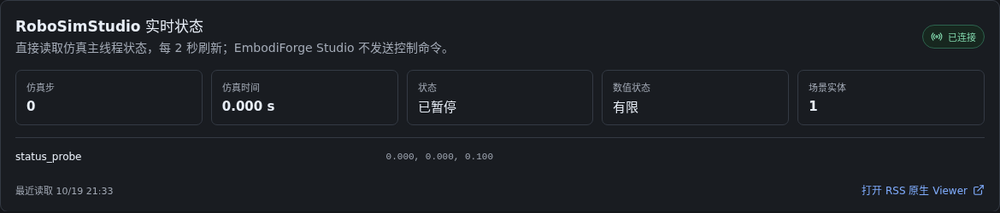

# EmbodiForge Studio 可视化验证记录

验证时间：2026-10-19，Asia/Shanghai。范围为可视化工作台，不重新运行或认证生成 pipeline。

## 交付范围

单入口提供项目归档、运行与阶段导航、当前/历史验收报告、视频与图片、日志、原生轨迹曲线、工具检索、RSS / DexAgent 的记录式 3D 回放，以及 SimFoundry 场景副本布局编辑。默认入口为 `http://127.0.0.1:8765`；远程 IDE 需转发该端口。本机本轮另按用户的远程查看需求启用 IPv4 监听，并通过 `http://172.18.78.80:8765` 验证页面、API 和视频元信息加载。

报告与媒体从原目录只读访问。项目归属、SQLite 索引、虚拟环境、构建、截图和派生 3D 缓存位于独立目录；生成预览不执行物理。当前服务健康状态为 `ok`，索引 55 个运行目录，该数量不代表成功任务数。

## 实际验证

| 检查 | 结果 | 覆盖范围 |
| --- | --- | --- |
| `python -m pytest -q workbench/tests` | 33 passed | 原有 31 项 + RSS 只读 socket 状态映射、未配置状态和请求白名单 |
| `npm run generate:api` | 通过 | 从当前 OpenAPI 生成 TypeScript；无手工放宽类型 |
| `npm run build` | 通过 | TypeScript strict 检查和 Vite 生产构建 |
| 背景与配色调整后的现有浏览器回归 | 10 passed，2.2 分钟 | 真实视频播放、刷新恢复、失败证据、工具详情、手机布局、键盘导航、两类原生曲线、两类真实 3D、跨运行预览隔离 |
| 本轮独立 8766 入口的原生场景编辑 | 1 passed，3.9 分钟 | 官方房间纹理；背景/实体隔离；隐藏背景时保存仍保留实体；Leave / Stay / Discard；历史续编、位姿和父版本；源摘要不变；无 API mock |
| 本轮移动端/键盘回归 | 2 passed；另有手机候选历史检查通过 | 390 px 页面无横向溢出，4 条真实候选可读；内网 8766 HTTP 200、浏览器错误 0；键盘导航与范围标签保留 |
| 总览首页定向回归（无 RSS 配置） | 3 passed，1 skipped，5.0 秒 | 真实 API 显示运行/场景/能力状态；验证续接 URL、未配置提示、状态 fixture 的步数/时间/实体位姿显示、RSS Viewer 跳转；未配置真实 RSS 时自动跳过真实会话用例 |
| RSS live 真实 socket 集成 | 1 passed | 在独立端口 8768 启动 RoboSimStudio 原生 live 服务和暂停的 Newton 刚体场景；EmbodiForge Studio API 实际读到 `status_probe`、位置 `[0, 0, 0.1]`、step 0、finite=true、paused=true |
| RSS live 真实页面端到端 | 1 passed，2.5 秒 | EmbodiForge Studio 连接上述 RSS 进程；浏览器实际显示已连接、步数/时间、暂停状态、实体名和位姿 |
| `npm audit --omit=dev` | 0 vulnerabilities | 本次锁定的生产依赖 |
| `git diff --check`、文档本地链接 | 通过 | 无空白错误、实施方案及启动说明的本地链接存在 |

真实浏览器使用 Chromium 151 / Playwright 1.62.1，适配本机 Ubuntu 20.04。浏览器测试读取现有文件和管理 API，没有拦截 API 后返回模拟成功数据。生命周期测试中的休眠子进程只证明监督行为，真实 3D 另由浏览器与人工截图检查验证。

RSS live 状态桥先通过临时 Unix socket fixture 验证协议与只读白名单，随后连接真实 RoboSimStudio live 进程完成 API 和浏览器端到端 smoke test。测试场景放在 `/tmp/embodiforge-rss-live-20261019/`，仿真保持暂停；状态由 RSS 原生 `cmd_status` 提供。截图是来自该真实会话的只读状态面板；此功能不会启动或控制 RSS，正式运行仍需配置 `WORKBENCH_RSS_RUN_DIR`。

本轮首次续编浏览器测试因固定导航遮挡 iframe 内对话框而中断；已修复请求前的编辑器滚动定位。随后一次测试以内容哈希定位版本时遇到相同内容的两个文件，改为唯一候选文件名定位，再核对摘要后通过。未使用强制点击跳过遮挡。

## 代表记录与状态口径

| 原生运行 | 实际展示 |
| --- | --- |
| `e2e_reference_layout_20261016` | 本次 Stage 3–4 范围完成；单次全流程未完成；跨调用证据完整；Stage 2 警告保留；发布资格未确认 |
| `rss_reference_cpu_final_20261016` | 37 项必需检查；保留 reference 复用警告；历史 task/embodiment/run_meta 缺失可浏览 |
| `rss_reference_raw_blocking_final_20261016` | 子目标 1 失败与下游受阻；不会被汇总页显示为成功 |

核验时标准案例 `run_summary.json` SHA-256 为 `7388b0c22e96fedd7a30c4ad946e8ac310946e304b87cb50e7133b90f4ced6b7`，`pipeline_validation.json` 为 `acd4994d4edd0c127b80f25a36a970fa00e42aabbe7175dba28bb66f6ac64094`。其他工作流后续修改源记录时，这些值仅代表本次查看的版本。

## 轨迹与 3D

| 来源 | 原始记录 | 可视化验证 |
| --- | --- | --- |
| RSS reference | 3925 帧，15.696 s，记录刚体 `body_q` | 模型/资产/刚体顺序和 xyzw 姿态一致；交互预览 301 帧；物理步数 0 |
| DexAgent 标准案例 | 532 帧，17.698 s；qpos 70 维、qvel 68 维、ctrl 56 维 | 使用原生 `time_s`；场景/资产/坐标身份与子步绑定一致；已有转换器执行正向运动学显示；预览 301 帧；物理步数 0 |

预览均匀采样，仅用于交互查看，原始记录可下载。快照按源内容摘要缓存；源记录版本变化时界面提示重新确认。不同 run 的预览 ID 不能在当前运行标题下展示。

已人工检查桌面媒体页、曲线页、手机验收页及原生 3D 真实几何截图。手机标题改为完整换行，顶部文字不再拆字换行，检查器在窄屏隐藏，阶段栏横向滚动；键盘可用方向键与 Home/End 切换内容页签。

本机临时证据保存在 `.workbench/validation_evidence.json` 和 `.workbench/previews/*-v2.png`，均不提交为源代码。

## 页面与背景改进

新增 `/` 总览首页，复用现有 health/scenes/capabilities/runs API 显示真实状态并链接已有页面；现在也会读取受管编辑会话，存在未关闭的场景副本时提供“继续场景编辑”入口，直接恢复原 scene/editor 上下文。桌面与手机布局截图为 `.workbench/previews/overview-dashboard-desktop.png`、`.workbench/previews/overview-dashboard-mobile.png`；不创建第二套任务状态，也不启用未接入的生成能力。

对照了 [SimFoundry 浏览器编辑器](../SimFoundry/scripts/interactive/light_editor/web/app.js)、[DexAgent 工具库](../library_visualizer/index.html) 与 [RSS 原生光照](../robosimstudio/robosimstudio_studio/lighting.py)：

- 页面改为中性深灰，43 处表面/分隔色常量合并到公共 CSS token，保留蓝色选中和独立验收状态色。原生内嵌编辑器使用同一套面板与强调色，独立启动的样式保留。
- SimFoundry 使用原场景的扫描背景和材质；未把背景资源替换成与任务无关的房间。DexAgent/RSS 记录回放保留源模型，复用 RSS 主光/补光且禁用外部 HDRI。新回放仍报告 `physics_steps_executed=0`。
- 原生编辑器新增可选 base path、实际动态端口就绪记录与同源内嵌，静态文件、GLB 和 API 经过同一个工作台入口。未改写传输中的 JavaScript，也未替换原生 three.js 编辑器。
- 保存发生在独立 scene 副本目录，附带来源摘要；原 JSON/USD 不变。不允许受管会话写共享任务/相机/房间 sidecar、覆盖 `_latest` 或发布。
- 修复虚拟环境解释器被解析到基础 Python 的问题；进程跟随 API 的生命周期，而非某个可退役的请求线程。暂时无响应保留 iframe；具体候选的旧修订提交返回 409。
- 场景候选按场景汇总所有历史会话并分页；重开核对所属场景与期望 SHA-256，保留原场景版本和父候选。来源损坏/删除后历史及下载仍可读取，重新编辑则明确拒绝。

官方样本来源为 `nadunRanawaka1/simfoundry-assets@beac75a98d99a881eacff25dd53a3ec9ce8efcfc` 和 `behavior-1k/omnigibson-robot-assets@c325bd3b6d1560d3145f3c9c0e885e79e47f180c`。实际下载版本、逐文件摘要位于 `.workbench/resources/simfoundry/*provenance.json`。房间代理 101233 顶点，机器人代理 520976 顶点，两个物体代理分别为 24547 / 20995 顶点；提取 manifest 为 `complete=true`。这些数字是可视代理规模，不代表物理精度。

已检查 `.workbench/previews/simfoundry-editor-verified.png`、`workbench-neutral-desktop.png`、`workbench-neutral-mobile.png` 和 `native-lighting-verified.png`。编辑候选供继续调试，尚未运行 OmniGibson settle/parity，不宣称新的物理验收通过。

## 扫描背景分离核查

按用户截图反馈，核查 `droid_v1.usd`：只有 `/droid_v1/base_link/Geom/mesh` 一个 mesh，101233 顶点，mesh 本身没有 CollisionAPI。场景 JSON 将机器人、杯子、垃圾桶、背景独立登记，但这不说明背景内容已经清理。

真实浏览器分别隔离后，背景仍含白色扫描机械臂；独立实体视图显示灰色机器人、杯子和垃圾桶。确认该公开背景自身含机器人残影；工作台未修改或清理其原 USD。隔离截图为 `.workbench/previews/background-isolated-verified.png` 和 `entities-isolated-verified.png`；续编截图为 `scene-history-verified.png`。

新增三个分层检查按钮，使用原生 `hiddenForView`，不删除物体或改变保存内容。SimFoundry 可选 auto-background 有 SAM3/SAM2、VOID、DA3/高斯流程，但常规 Stage 2c 与当前样本不具备同一套已验收的清理证据。背景清理、机器人/实例排除、静态支撑与碰撞分离已补入两份方案；仍需 pipeline 侧实际生成并在目标运行时验收。

为保留 8765 上现有编辑会话，本轮新构建用 `--frontend-dist .workbench/staging-dist` 在独立 8766 服务验证，管理数据位于 `.workbench/staging`；两个入口读取相同原始运行，场景副本各自保存。正式入口升级应在旧会话保存/停止后进行，未强制中断当前用户会话。

## 剩余限制

- SimFoundry 原位离线布局编辑已验证；实时物理控制、候选的物理验收和发布未接入。下载的候选 JSON 仍引用本机资产，不等于可移植发布包。
- 当前官方扫描背景含原机械臂，尚不满足干净静态环境的要求；分层显示通过不能放行正式训练数据。
- pipeline 启动/重试和算法优化由另一工作流负责；训练格式导出未纳入本次交付。
- 3D 首次生成需 CPU 内核编译；浏览器在本次无头环境使用软件 WebGL，保留原生提示。未宣称硬件 GPU 性能已经验收。
- ECharts 延迟加载包约 531 kB，Vite 保留大于 500 kB 的提示；它在打开曲线时才加载，未通过提高阈值隐藏警告。
- 默认仅监听本机；本次为用户的内网查看显式开启 IPv4 监听。尚未提供面向公网的认证与部署方案。
